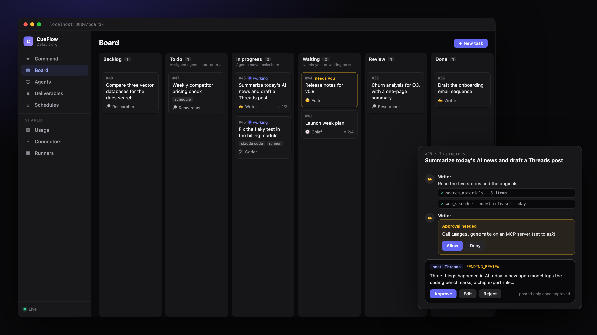

<h1 align="center">CueFlow</h1>

<p align="center">
  Open-source, self-hosted agent ops console.<br>
  Give a team of AI agents tasks on a kanban board. They work with their own tools, ask you when they need a
  decision, and nothing they produce acts on the world until you approve it.
</p>

<p align="center">
  <a href="https://github.com/j75689/cueflow/actions/workflows/ci.yml"></a>
  <a href="LICENSE"></a>
  <a href="go.mod"></a>
</p>

<p align="center">
  <a href="#quick-start">Quick Start</a> ·
  <a href="#how-it-works">How It Works</a> ·
  <a href="#interfaces">Interfaces</a> ·
  <a href="#documentation">Docs</a> ·
  <a href="CONTRIBUTING.md">Contributing</a>
</p>

<p align="center">
  <a href="README.md"></a>
  <a href="README.zh-TW.md"></a>
</p>

<p align="center">
  
</p>

---

## Quick Start

Runs on any machine with Docker (a NAS, a home lab, a laptop). It only makes outbound connections: no public IP,
domain or webhook needed.

```bash
git clone https://github.com/j75689/cueflow && cd cueflow/deploy
cp .env.example .env
# fill in CUEFLOW_SECRET_KEY (openssl rand -base64 32) and SEARXNG_SECRET (openssl rand -hex 32)
docker compose up -d
```

CueFlow is at <http://localhost:3000> (every port is bound to `127.0.0.1`). Then:

1. **Connectors**: add an LLM (e.g. *Anthropic Claude*, or *OpenAI-compatible* pointing at Ollama), and whatever
   the agents need: MCP servers as tools, web search, RSS feeds or mailboxes.
2. **Agents**: a new install has only the 🧭 Chief. Add roles by hand, or import a team template from
   [`templates/`](templates/) (Agents → *Import team*).
3. **Command**: tell the team what you want, or set up a **Schedule** for recurring work.
4. **Deliverables**: read, edit, approve or reject what the agents produced.

> [!TIP]
> To try the social posting flow without posting anywhere, start the bundled mock publisher
> (`docker compose --profile mock up -d`) and add an *MCP publisher* connector with endpoint
> `http://mock-publisher:4010/mcp` and token `dev-token`.

Image variants (with Node and the ACP adapters for external agents), web search, remote access:
[docs/docker.md](docs/docker.md). Back up `CUEFLOW_SECRET_KEY`: without it stored credentials are unreadable.

### Google Cloud Run

To run it always on and scaling to zero between jobs, see [deploy/cloudrun/README.md](deploy/cloudrun/README.md).

---

## How It Works

A request goes through the same steps whether you typed it, a schedule fired it, or another agent sent it over MCP:

1. **Ask.** Tell the team what you want on the Command page, e.g. "Every morning at 8, summarize AI news and draft a
   Threads post". Every request becomes a task card: Backlog → To do → In progress → Waiting → Review → Done.
2. **Plan.** The Chief plans, splits the work into subtasks for the right agents, and sets up schedules when the
   work recurs. Each agent has its own persona, capabilities, LLM, sources and memory.
3. **Work.** An agent works with its tools: built-in ones, any [MCP](https://modelcontextprotocol.io) server (each
   tool set to allow, ask or deny), or it hands the whole task to Claude Code, Codex, Gemini CLI, OpenCode or Goose
   over ACP, on the server or on a machine you own.
4. **Ask you.** Questions and risky tool calls wait in the task's thread. Reply to continue, or `@writer` to hand
   the task to another agent; every thought and tool call is visible there.
5. **Review.** What the agents produce is a **deliverable**: a document or, with the content module, a social post.
   It waits for you to edit, approve or reject it.
6. **Act.** Only an approved item is acted on: filed through an action connector, or published through any MCP server
   that follows the four-tool [publisher contract](docs/publisher-mcp.md). No agent tool can act, and connectors
   refuse unless the worker attached a grant for that exact, approved item.

Capabilities and tools, the task state machine, delegation and guardrails: [docs/agentic-flow.md](docs/agentic-flow.md).

---

## Interfaces

- **Dashboard**: Command, Board, Agents, Deliverables, Schedules, Connectors, Runners and Usage, embedded in the
  server binary.
- **MCP endpoint**: other agents (Claude Code, Codex...) can list, create, comment on, run and stop tasks and read
  deliverables through CueFlow's own MCP server. Approving stays in the dashboard.
- **REST API**: everything the dashboard does, with a bearer token. [docs/api.md](docs/api.md)
- **Runners**: `cueflow runner` on a machine you own picks up tasks for external agents; it only makes outbound
  connections. [docs/external-agents.md](docs/external-agents.md)

---

## Features

| | |
|---|---|
| **Human in the loop by construction** | Deliverables follow a strict state machine (`DRAFT → PENDING_REVIEW → APPROVED \| REJECTED → QUEUED → DONE \| FAILED`); every change is in an audit log, with diffs of reviewer edits |
| **Agent teams as files** | Export an org's agents as a JSON team template and import it elsewhere, like a Grafana dashboard |
| **External agents** | Claude Code, Codex, Gemini CLI, OpenCode and Goose over ACP, on the server or on your own machines |
| **Tool policy** | Any MCP server as agent tools; each tool allowed, asked about or denied |
| **Schedules** | Recurring tasks for an agent; agents can create them too |
| **Connector plugins** | LLMs, MCP servers, search, sources, notifiers, image generators, publishers and actions implement small Go interfaces; the UI renders their forms. [List](docs/builtin-connectors.md) · [Writing one](docs/connectors.md) |
| **Modules** | Deliverables and social content are modules you switch with `CUEFLOW_MODULES`. [docs/modules.md](docs/modules.md) |
| **Private by default** | At home it binds to `127.0.0.1` and only connects outward; in the cloud the dashboard sits behind Cloudflare Access. Secrets are encrypted at rest (AES-256-GCM) |
| **Crash-safe actions** | The worker uses leases: one that dies mid-action leaves the item `FAILED` with a "check before retrying" note instead of acting twice |
| **Single binary** | Go API, scheduler and worker with the Next.js dashboard embedded |

---

## Documentation

- [Architecture](docs/architecture.md), with the package layout in §2.1 · [Agentic flow](docs/agentic-flow.md)
- [REST API](docs/api.md) · [Configuration](docs/configuration.md), every environment variable and key rotation
- [Running with Docker Compose](docs/docker.md) · [Deploying on Google Cloud Run](deploy/cloudrun/README.md) ·
  [A runner in a container](deploy/runner/README.md)
- [Built-in connectors](docs/builtin-connectors.md) · [Writing a connector plugin](docs/connectors.md) ·
  [Publisher MCP contract](docs/publisher-mcp.md)
- [External agents, runners and MCP](docs/external-agents.md)
- [Modules: deliverables, content, images and videos](docs/modules.md) · [Team templates](templates/README.md)

---

## Contributing

Go 1.27+, Node 22+ and Docker (for PostgreSQL); `make test-db`, `go run ./cmd/cueflow`, `cd web && npm run dev`.
The full setup, the rules that are not negotiable and the commit convention are in [CONTRIBUTING.md](CONTRIBUTING.md).

## Security

Found a vulnerability? Report it privately, never in a public issue or PR:
[Report a vulnerability](https://github.com/j75689/cueflow/security/advisories/new). Scope and what to include:
[SECURITY.md](SECURITY.md).

## License

[Apache License 2.0](LICENSE).
