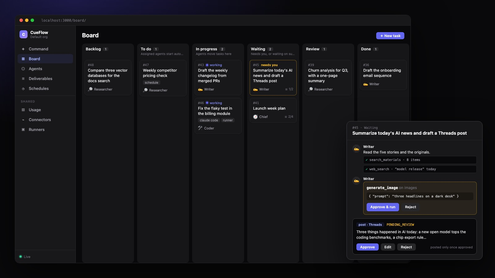

<h1 align="center">CueFlow</h1>

<p align="center">
  開源、可自託管的 Agent 運營控制台。<br>
  把任務交給看板上的一組 AI agent：它們用各自的工具做事，需要你決定時會來問，有風險的工具呼叫和它們的產出都會等你核准。
</p>

<p align="center">
  <a href="https://github.com/j75689/cueflow/actions/workflows/ci.yml"></a>
  <a href="LICENSE"></a>
  <a href="go.mod"></a>
</p>

<p align="center">
  <a href="#快速開始">快速開始</a> ·
  <a href="#運作方式">運作方式</a> ·
  <a href="#使用介面">使用介面</a> ·
  <a href="#文件">文件</a> ·
  <a href="CONTRIBUTING.md">參與貢獻</a>
</p>

<p align="center">
  <a href="README.md"></a>
  <a href="README.zh-TW.md"></a>
</p>

<p align="center">
  
</p>

---

## 快速開始

任何有 Docker 的機器都能跑（NAS、Home Lab、筆電）。它只做主動連線，不需要 Public IP、網域或 Webhook。

```bash
git clone https://github.com/j75689/cueflow && cd cueflow/deploy
cp .env.example .env
# 填入 CUEFLOW_SECRET_KEY（openssl rand -base64 32）與 SEARXNG_SECRET（openssl rand -hex 32）
docker compose up -d
```

CueFlow 在 <http://localhost:3000>（所有連接埠都只綁 `127.0.0.1`）。接著：

1. **Connectors**：加一個 LLM（例如 *Anthropic Claude*，或指向 Ollama 的 *OpenAI-compatible*），再加 agent 需要的東西：當工具用的 MCP 伺服器、網頁搜尋、RSS feed 或信箱。
2. **Agents**：全新安裝只有 🧭 Chief。可以手動新增角色，或從 [`templates/`](templates/) 匯入團隊範本（Agents → *Import team*）。回覆與寫稿的語言由各角色的 `language` 決定（預設 `en`，要繁體中文請改成 `zh-TW`）。
3. **Command**：直接告訴團隊要做什麼，或建立 **Schedule** 定時執行。
4. **Deliverables**：閱讀、修改、核准或退回 agent 的產出。

> [!TIP]
> 想試社群發文流程又不想真的發出去，可以啟動內附的 mock 發布器（`docker compose --profile mock up -d`），再新增一個 *MCP publisher* connector，endpoint 填 `http://mock-publisher:4010/mcp`、token 填 `dev-token`。

映像版本（含 Node 與 Claude Code、Codex 的 ACP adapter）、網頁搜尋、遠端存取：[docs/zh-TW/docker.md](docs/zh-TW/docker.md)。請備份 `CUEFLOW_SECRET_KEY`，沒有它存好的憑證就解不開。

### Google Cloud Run

想一直在線、沒工作時縮到零，見 [deploy/cloudrun/README.md](deploy/cloudrun/README.md)（英文）。

---

## 運作方式

不論需求是你打的、排程觸發的，還是別的 agent 透過 MCP 送來的，都走同樣的步驟：

1. **提出需求。** 在 Command 頁說你要什麼，例如「每天早上 8 點整理 AI 新聞並寫成 Threads 草稿」。每個需求都會變成一張任務卡：Backlog → 待辦 → 進行中 → 等待中 → 待確認 → 完成。
2. **規劃。** Chief（總管）規劃步驟，把工作拆成子任務交給合適的 agent；需要定期做的就設成排程。每個 agent 有自己的人設、能力、LLM、資料來源與記憶。
3. **執行。** Agent 用它的工具做事：內建工具、任何 [MCP](https://modelcontextprotocol.io) 伺服器（每個工具可設為允許、需核准或禁止），或把整個任務交給 Claude Code、Codex、Gemini CLI、OpenCode 或 Goose 透過 ACP 執行，跑在伺服器上或你自己的機器上。
4. **問你。** 提問與有風險的工具呼叫會在任務的對話串裡等你。回覆就能讓它繼續，用 `@writer` 開頭可以把任務轉給另一個 agent；每一步思考與工具呼叫都看得到。
5. **審核。** Agent 的產出是一份 **deliverable**：一份文件，或（有內容模組時）一則社群貼文，等你修改、核准或退回。
6. **執行動作。** 只有核准的項目才會被執行：透過 action connector 送出，或透過任何符合四個工具的[發布器約定](docs/publisher-mcp.md)（英文）的 MCP 伺服器發布。沒有任何 agent 工具能發布或執行動作，這些 connector 也只接受 worker 針對「那一份已核准的項目」給的授權。

能力與工具、任務狀態機、委派與防護：[docs/zh-TW/agentic-flow.md](docs/zh-TW/agentic-flow.md)。

---

## 使用介面

- **儀表板**：Command、Board、Agents、Deliverables、Schedules、Connectors、Runners 與 Usage，內嵌在伺服器 binary 裡。
- **MCP 端點**：其他 agent（Claude Code、Codex⋯）可以透過 CueFlow 自己的 MCP 伺服器列出、建立、留言、執行與停止任務，也能讀 deliverable。核准仍然只能在儀表板做。
- **REST API**：儀表板做得到的都能用 bearer token 呼叫。[docs/api.md](docs/api.md)（英文）
- **Runner**：在你自己的機器上跑 `cueflow runner`，替外部 agent 接任務；它只做主動連線。[docs/zh-TW/external-agents.md](docs/zh-TW/external-agents.md)

---

## 特色

| | |
|---|---|
| **從架構上保證人工審核** | Deliverable 遵循嚴格的狀態機（`DRAFT → PENDING_REVIEW → APPROVED \| REJECTED → QUEUED → DONE \| FAILED`），每次變動都寫入稽核紀錄，包含審核者修改前後的差異 |
| **團隊就是一個檔案** | 把 org 的 agent 匯出成 JSON 團隊範本，再匯入到別處，用法和 Grafana 的 dashboard 一樣 |
| **外部 agent** | Claude Code、Codex、Gemini CLI、OpenCode 與 Goose 透過 ACP 執行，跑在伺服器或你自己的機器上 |
| **工具權限** | 任何 MCP 伺服器都能當 agent 的工具，每個工具可設為允許、需核准或禁止 |
| **排程** | 定時為 agent 建立任務；agent 也能自己建立排程 |
| **Connector 插件** | LLM、MCP 伺服器、搜尋、資料來源、通知、圖片生成、發布器與 action 都實作簡單的 Go 介面，UI 自動產生設定表單。[清單](docs/zh-TW/builtin-connectors.md) · [自己寫一個](docs/connectors.md)（英文） |
| **模組** | Deliverable 與社群內容都是模組，用 `CUEFLOW_MODULES` 開關。[docs/zh-TW/modules.md](docs/zh-TW/modules.md) |
| **預設私有** | 在家裡只綁 `127.0.0.1`、只做主動連線；在雲端，儀表板放在 Cloudflare Access 後面，機器之間的呼叫都帶 Google 簽發的身分。機密以 AES-256-GCM 加密儲存 |
| **動作不怕當機** | worker 使用租約：執行途中掛掉，項目會標成 `FAILED` 並提醒「重試前請先確認」，而不是做第二次 |
| **單一 binary** | Go 的 API、排程與 worker，加上內嵌的 Next.js 儀表板 |

---

## 文件

- [整體架構設計](docs/zh-TW/architecture.md)，套件結構在 §2.1 · [Agentic flow 設計](docs/zh-TW/agentic-flow.md)
- [設定](docs/zh-TW/configuration.md)：所有環境變數與金鑰更換
- [用 Docker Compose 執行](docs/zh-TW/docker.md) · [自訂 Runner 映像](docs/zh-TW/runner-image.md)
- [內建 connector](docs/zh-TW/builtin-connectors.md) · [外部 agent、Runner 與 MCP](docs/zh-TW/external-agents.md)
- [模組：deliverables、content、圖片與影片](docs/zh-TW/modules.md)
- 英文文件：[REST API](docs/api.md) · [Connector 插件開發](docs/connectors.md) · [發布器 MCP 約定](docs/publisher-mcp.md) · [團隊範本](templates/README.md) · [部署到 Google Cloud Run](deploy/cloudrun/README.md) · [容器裡的 Runner](deploy/runner/README.md)

---

## 參與貢獻

需要 Go 1.27+、Node 22+、Docker（跑 PostgreSQL 用）；`make test-db`、`go run ./cmd/cueflow`、`cd web && npm run dev`。完整的開發設定、不可妥協的規則與 commit 慣例在 [CONTRIBUTING.md](CONTRIBUTING.md)（英文）。

## 安全性

發現漏洞請私下通報，不要開公開 issue 或 PR：[回報漏洞](https://github.com/j75689/cueflow/security/advisories/new)。範圍與要附的資訊見 [SECURITY.md](SECURITY.md)（英文）。

## 授權

[Apache License 2.0](LICENSE)。
