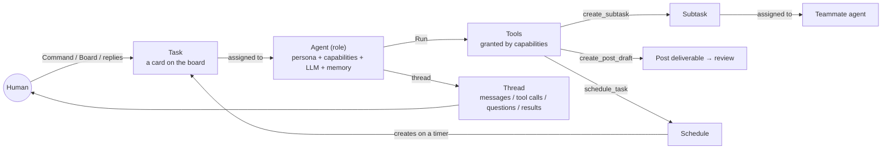
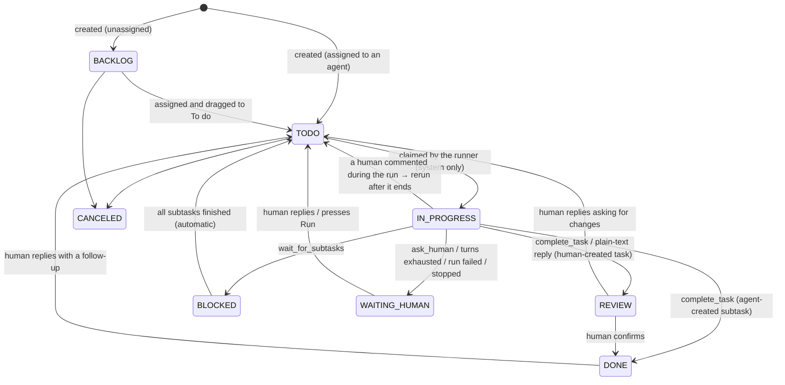
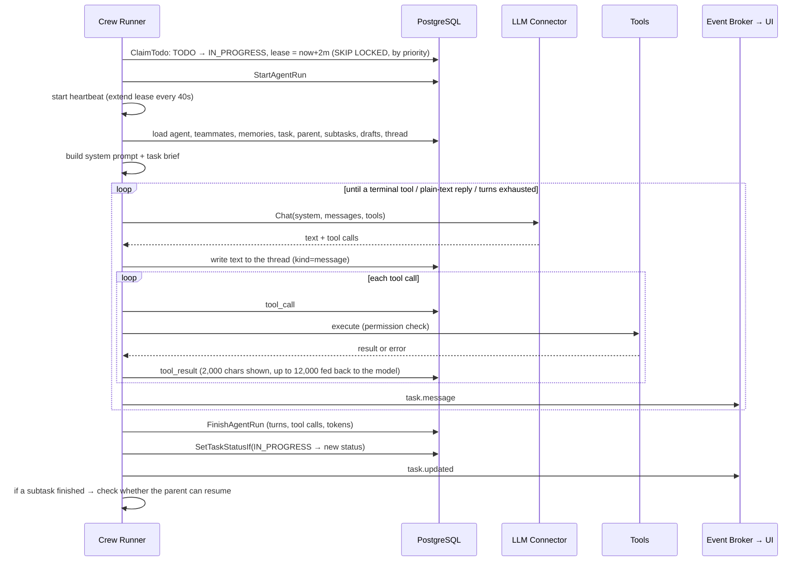
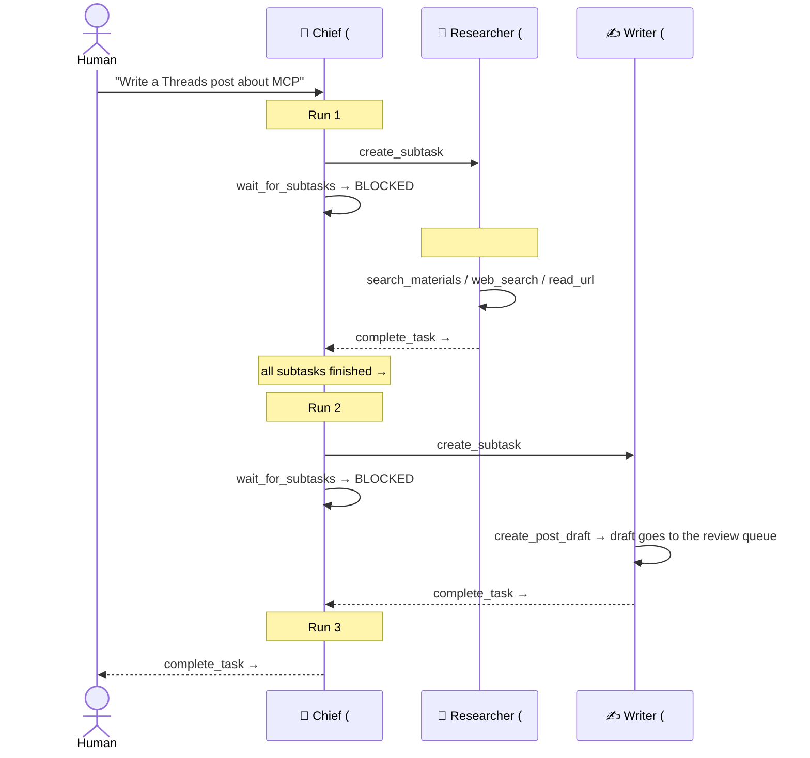
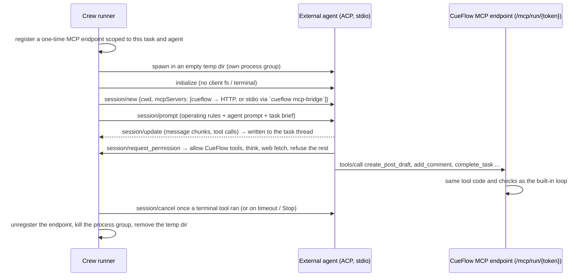

# Agentic Flow Design

> Traditional Chinese version: [docs/zh-TW/agentic-flow.md](zh-TW/agentic-flow.md)

> How CueFlow's agent team understands requests, divides work, executes and collaborates with humans.
> For the overall system see [architecture.md](architecture.md); for the APIs see the Agents / Tasks / Schedules
> sections of [api.md](api.md).

## 1. Goals and positioning

You tell CueFlow what you want in one sentence (like talking to a chat bot), and a team of specialised agents gets it done: they understand the request, break it down, hand parts to teammates, gather material, write drafts, set up recurring work, and report back. The whole process is laid out on a board, and you can step in at any time.

The design has three hard lines:

1. **Agents cannot publish.** Drafts always go to the review queue and only a human can approve them. This is the PRD's human-in-the-loop principle and the foundation of the security model.
2. **Everything is visible and can be taken over.** Every thought, tool call and result an agent produces is written to the task thread; humans can reply, reassign, drag cards and stop runs.
3. **Bounded.** Turns, subtasks, drafts, delegation depth and schedule frequency are all capped, preventing runaway loops and costs.

## 2. Core concepts

| Concept | Description |
|---|---|
| **Agent (role)** | Name, slug (for `@mentions` and delegation), avatar, role type, description (its introduction to teammates), instructions (persona and standing orders), capabilities, LLM / search / source connectors, language, platforms, turn limit |
| **Capability** | A permission group of tools. An agent only sees the tools within its capabilities |
| **Task** | A card on the board: title, description, status, priority, labels, assignee, parent task, result |
| **Thread** | The message stream under a task: human and agent messages, tool calls and results, system status, questions, the final result |
| **Run** | One working session of an agent on a task; a task can have several runs (e.g. resumed after waiting for subtasks) |
| **Memory** | Notes an agent keeps across tasks (preferences, facts, decisions); the latest 30 are included in every run |
| **Schedule** | A cron that creates a task for an agent |

## 3. Default team

On first start, when no agents exist, the system creates a single agent, the Chief (`internal/crew/defaults.go`). It can be edited in the UI, and you add the rest of the team yourself: by hand, or by importing a **team template**, a JSON file like a Grafana dashboard (Agents → *Import team*; *Export team* writes one from an org). The repository ships [`templates/social-content.json`](../templates/social-content.json), the researcher, writer and editor below:

| Role | slug | Capabilities | Responsibility |
|---|---|---|---|
| 🧭 Chief (created for you) | `chief` | planning, delegation, memory, research, sources, post_deliverables, deliverables | The front desk: understands requests, breaks them down, delegates to the agents you add (or does the work itself when none fits), sets up schedules, reports back; turn limit 16 |
| 🔎 Researcher (example template) | `researcher` | research, sources, memory | Gathers and verifies information, produces summaries with sources |
| ✍️ Writer (example template) | `writer` | post_deliverables, imaging, research, sources, memory | Writes drafts in each platform's style |
| 🧐 Editor (example template) | `editor` | post_deliverables, memory | Checks pending drafts for facts, tone and platform rules, and revises them (cannot approve) |

The default names and instructions are in English; the language agents write in follows each agent's `language` setting (default `en`).

## 4. Capabilities and tools

| Capability | Tool | Description |
|---|---|---|
| (all agents) | `add_comment` | Post a progress update to the thread |
| | `ask_human` | Ask a question and pause until a human replies (ends the run) |
| | `complete_task` | Report the result and finish (ends the run) |
| research | `web_search` | Search via SearXNG / Tavily |
| | `read_url` | Read a public web page (internal networks blocked, see §10) |
| sources | `search_materials` | Search material already collected from RSS / mail (the agent's Sources, or all when none are picked) |
| | `fetch_sources` | Pull the latest items from source connectors now |
| post_deliverables ("Drafting") | `create_post_draft` | Create a `post` deliverable for one platform (optional Threads `topic`, `link` card, `publish_at` time and `media_urls`, e.g. a video a tool rendered); it goes straight to `PENDING_REVIEW` |
| | `list_posts` | List post deliverables and their review status |
| | `revise_draft` | Revise a draft still in `DRAFT` / `PENDING_REVIEW` (audited as the agent) |
| imaging | `generate_image` | Generate an image with the first active image connector and attach it to an editable draft (default prompt: the draft's `image_prompt`). At most 2 per run, since each image costs money |
| deliverables | `create_deliverable` | File a deliverable of any registered kind (`document` by default) for human review; it goes straight to `PENDING_REVIEW` |
| | `list_deliverables` | List the org's deliverables and their status |
| | `revise_deliverable` | Revise one still in `DRAFT` / `PENDING_REVIEW` (audited as the agent) |
| delegation | `create_subtask` | Create a subtask assigned to a teammate (starts immediately) |
| | `list_agents` | List teammates available for delegation |
| | `wait_for_subtasks` | Pause until all subtasks finish, then be resumed (ends the run) |
| planning | `list_tasks` / `get_task` | Look at tasks on the board |
| | `create_task` | Create a standalone task (not a subtask) |
| | `schedule_task` / `list_schedules` / `pause_schedule` | Manage recurring tasks |
| memory | `remember` / `search_memory` | Save / search long-term memory |

**Tool permissions have three layers of defense:**

1. **Declaration**: the tool list sent to the LLM contains only tools within the agent's capabilities.
2. **Execution**: if the model calls a tool outside its list (e.g. it is tricked into calling a publisher's `create_post`), the runner returns an error result "Tool is not available to you" and records it in the thread.
3. **Publishing**: even if someone wired a publisher into an agent by mistake, agent runs carry the `guard.WithAgent` marker and `guardedPublisher` always refuses.

## 5. Task state machine

| Status | Board column | Meaning |
|---|---|---|
| `BACKLOG` | Backlog | An idea, not started |
| `TODO` | To do | Ready; claimed automatically if assigned to an agent |
| `IN_PROGRESS` | In progress | An agent is working (set by the system only; humans cannot drag cards here) |
| `BLOCKED` | Waiting | Waiting for subtasks |
| `WAITING_HUMAN` | Waiting (needs you) | The agent asked a question, the run failed, or turns ran out |
| `REVIEW` | Review | The agent finished; a human checks the result |
| `DONE` / `CANCELED` | Done / hidden | Finished |

Unlike the deliverable state machine, task status is permissive for humans: cards can be dragged freely on the board (except into In progress). The strict part is when an agent finishes: the new status is applied only if the task is **still `IN_PROGRESS`** (`SetTaskStatusIf`). If a human drags the card away during a run, the agent's result is written to the thread but the card is not pulled back.

## 6. Lifecycle of a run

### 6.1 Stateless runs

Every run **rebuilds its context from scratch** instead of replaying the previous run's raw LLM messages:

- **System prompt**: general working rules + role description + delegation rules and team roster (with the delegation capability) + scheduling rules (with planning) + the role's instructions + the latest 30 memories + the current time.
- **Task brief (the first user message)**: task title, priority, labels, due date, description, parent task, all subtasks and their results, drafts already created, and the latest 60 thread messages (tool results compressed to 500 characters).

Benefits:
- Provider-agnostic: no need to persist each LLM vendor's native message format; a task can switch LLM or agent midway and carry on.
- Human replies in the thread, teammates' subtask results and system messages naturally become context for the next run.
- Within a single run the native format is preserved (e.g. Anthropic thinking blocks are passed back unchanged), so the tool loop stays faithful.

### 6.2 How runs end

| End reason | Written to the thread | New status | Run record |
|---|---|---|---|
| `complete_task` | `result` | Human-created task → `REVIEW`; agent-created subtask → `DONE` | SUCCEEDED |
| Plain-text reply (no tool call) | `result` | Same as above (treated as done; suits Q&A tasks) | SUCCEEDED |
| `ask_human` | `question` | `WAITING_HUMAN` | SUCCEEDED |
| `wait_for_subtasks` | system message | `BLOCKED` (straight back to `TODO` if the subtasks have in fact all finished) | SUCCEEDED |
| Turns exhausted | system message (reply to continue or raise the limit) | `WAITING_HUMAN` | FAILED |
| LLM / configuration error | system message (with the error) | `WAITING_HUMAN` | FAILED |
| Stopped by a human | "Stopped." | `WAITING_HUMAN` | CANCELED |
| Process restart, lease expired | system message (explaining the interruption) | `WAITING_HUMAN` | FAILED |

**A human comments during a run**: the runner does not interrupt the in-flight LLM call. When the run ends it checks whether any human message arrived after the run started. If so, it does not apply the completion status; it moves the task back to `TODO` and reruns immediately so the new comment is handled (except when the run was stopped or failed).

## 7. Delegation and resumption

Rules:

- A subtask is `TODO` and assigned the moment it is created, and the runner claims it immediately; up to 3 tasks run in parallel (`CUEFLOW_AGENT_CONCURRENCY`).
- After the parent calls `wait_for_subtasks` it is `BLOCKED`. Whenever any subtask enters `DONE` / `REVIEW` / `CANCELED` (whether an agent finished it or a human dragged it on the board), the system checks whether all subtasks are finished; if so, it posts a summary of the subtask results to the parent's thread and moves the parent back to `TODO`.
- If a subtask is stuck in `WAITING_HUMAN` (e.g. the researcher has a question), the parent stays `BLOCKED` until a human deals with it.
- Delegation is at most 3 levels deep (root task → subtask → sub-subtask); a sub-subtask cannot delegate further.

## 8. Human-agent collaboration

| Human action | System behavior |
|---|---|
| Send a request in Command | Creates a `TODO` task assigned to the chosen agent (Chief by default) and opens the task page |
| Add a card on the board and assign it | Starts in `TODO` if assigned to an agent, otherwise `BACKLOG` |
| Drag a card to To do | Starts automatically if an agent is assigned |
| Comment in the thread | If the task has an agent and is not in `BACKLOG` / `CANCELED` → moves to `TODO` and the agent continues after reading the comment; if a run is in progress, it reruns automatically when the run ends |
| Start a comment with `@slug` | First hands the task to that agent (a running run is stopped), then behaves as above |
| Press Stop or drag a running card away | Cancels the run's context, aborting the LLM call; the task stays in `WAITING_HUMAN` or the column you dropped it in |
| Reassign to another agent | A running run is stopped |
| Review drafts | Agent drafts are like any other draft: they reach the publisher only after approval on the Deliverables page |

## 9. Schedules

- Created by humans on the Schedules page, or by agents with the planning capability via `schedule_task` (marked `created_by: agent`; the UI shows "created by agent").
- Each firing creates a new task: the title gets the date, a `scheduled` label is added, it is assigned to the configured agent, and the runner is woken immediately.
- Validation: a valid 5-field cron or a descriptor such as `@daily`; consecutive firings must be ≥ 5 minutes apart (checked over the next 5 firings), so an agent cannot create an every-minute schedule. On a validation error the error is returned to the agent so it can correct itself.
- `Run now` creates one task immediately.

### Publishing defaults

A schedule (or a task) can name a publisher and accounts (`publisher_connector_id`,
`publish_accounts`). Tasks created by the schedule copy them, subtasks inherit them from their parent,
and every draft an agent writes for such a task starts with that publisher and the accounts that are on
the draft's platform. When accounts are picked, the brief tells the agent which platforms they cover
and `create_post_draft` refuses drafts for any other platform (e.g. no Instagram draft when only a
Threads account is picked). Drafts still wait for a human on the Deliverables page; the defaults only save picking the
target each time.

## 10. Guardrails and limits

| Item | Limit / behavior | Where |
|---|---|---|
| Turns per run | The role's `max_turns` (default 12, Chief 16, max 40) | `store/agents.go` |
| Subtasks + standalone tasks created per run | 8 | `crew/tools.go` |
| Drafts created per run | 10 | `crew/tools.go` |
| Delegation depth | 3 levels | `crew/tools.go` |
| A single tool result fed back to the model | 12,000 characters (truncated to 2,000 when shown in the thread) | `crew/crew.go` |
| Thread messages in the task brief | Latest 60 | `crew/prompt.go` |
| Memories included | Latest 30, 2,000 characters each | `crew/crew.go`, `store/agents.go` |
| Schedule frequency | ≥ 5 minutes | `scheduler.ValidateSchedule` |
| Parallel tasks | 3 (`CUEFLOW_AGENT_CONCURRENCY`) | `config` |
| Run lease | 2 minutes, renewed every 40 seconds; expired → `WAITING_HUMAN` | `crew/crew.go` |
| `read_url` | http(s) only; blocks loopback / private / link-local / CGNAT / multicast at dial time; at most 5 redirects; 2 MB, 8,000 characters, 30 seconds; bypasses the system proxy (`CUEFLOW_AGENT_ALLOW_PRIVATE_URLS=true` relaxes this) | `crew/fetch.go` |
| Publishing | Impossible for any agent, see §4 | `guard`, `connector` |

## 11. Prompt design

The system prompt is assembled by code in a fixed order:

1. **Identity and working rules**: who you are, you are working on task #N, make progress autonomously, ask humans only when necessary, you cannot publish, facts need sources, report progress on long tasks, finish with a `complete_task` summary, communicate in the configured language.
2. **Delegation rules and team roster** (with the delegation capability): each teammate's slug, role, description and capabilities; guidance to "hand work to the specialist, but don't open subtasks for trivial steps" and to check subtask results before completing.
3. **Scheduling rules** (with the planning capability): use a schedule instead of doing recurring requests once, and infer a suitable timezone.
4. **Role instructions**: the persona and standing orders the user edits in the UI.
5. **Memories** and the **current time**.

All differences between roles come from "capabilities (which tools they see)" plus "instructions (how they work)", so adding a role (e.g. a data analyst or a customer-reply agent) needs no code changes.

## 11a. External agents (ACP runtime)

An agent can delegate its runs to an external coding agent instead of CueFlow's built-in LLM loop. The
agent's **Runtime** points at an *External agent (ACP)* connector (`acp_agent`, kind `runtime`) that describes
how to launch it: presets for Claude Code (`claude-agent-acp`), Codex (`codex-acp`), Gemini CLI
(`gemini --acp`), OpenCode (`opencode acp`), Goose (`goose acp`), or a custom command; credentials (API key,
Claude Code OAuth token from `claude setup-token`) are stored encrypted on the connector and passed as
environment variables.

- **Same tools, same guarantees.** The MCP endpoint serves exactly the tools of the agent's capabilities,
  executed by the same code as the built-in loop (thread logging, limits, drafts to review). There is still
  no publishing tool.
- **Permission policy.** CueFlow's MCP tools, `think` and (optionally) `fetch` are allowed; `execute`, `edit`,
  `read`, `delete`, `move`, `search` and anything else are refused and noted in the thread. The client also
  declares no file system or terminal capability.
- **Stateless runs.** Each run is a fresh ACP session seeded with the task brief, exactly like the built-in
  loop; no session IDs to manage.
- **Outcome mapping.** A terminal tool decides the outcome; otherwise `end_turn` → completed with the agent's
  last message, `max_turn_requests`/`max_tokens` → turn limit, `refusal` → failed, timeout → failed.
- **Tokens.** Usage is recorded when the agent reports it in the prompt result.

## 11b. External tools (MCP servers)

An operator can add an **MCP server** connector (kind `tools`: Streamable HTTP, SSE or stdio) and
attach it to agents (`tool_connector_ids`). Its tools appear to those agents as `<server>__<tool>`,
next to the built-in tools, for both the built-in loop and ACP runtimes.

Each tool has a permission, set on the connector page:

| Permission | Effect |
|---|---|
| `allow` | the agent calls it directly |
| `ask` | the call is recorded (`tool_approvals`), shown in the task thread as an approval card, and the run ends with the task in `WAITING_HUMAN`. **Approve & run** executes the call server-side and posts the result to the thread; **Reject** posts the refusal (with an optional note). Once no approval is pending, the task goes back to `TODO` and the agent resumes with the outcome in its brief |
| `deny` | the agent never sees it |

Each connector has a call timeout (`timeout_minutes`, default 2); raise it for slow tools such as video
rendering. Tools without a stored permission use the default: `allow` when the server marks them read-only (or the
name reads like a lookup: get, list, search...), otherwise `ask`. Tools that look like they publish,
message people, delete data or move money are flagged *risky*; allowing one asks for confirmation. A
server that adds tools later gets the defaults for them, so no new tool runs unattended unless it is
read-only. Permissions are the operator's call: an allowed tool runs outside CueFlow's review.

## 12. End-to-end example

In Command, the user types: "Every morning at 8, summarize AI news and draft a Threads post".

1. Task #1 is created, assigned to Chief, status `TODO`.
2. **Chief, run 1**: recognises a recurring request. If the time were unclear it would `ask_human`; here 8 a.m. is given, so it calls `schedule_task` directly (`0 8 * * *`, `Asia/Taipei`, assigned to Writer, with a description asking it to gather the previous day's AI news and write a draft), uses `remember` to note "the user wants AI news drafts every day at 8", and finally `complete_task` reports what it set up. #1 → `REVIEW`.
3. The next day at 08:00, the schedule creates task #2 "Summarize AI news and draft a Threads post · 2026-10-05", assigned to Writer, which starts automatically.
4. **Writer, run**: `fetch_sources` → `search_materials` → `web_search` / `read_url` to verify when needed → `create_post_draft` (Threads; anything over 500 characters is split into a thread automatically) → `complete_task` reports the draft ID. #2 → `REVIEW`.
5. You see the draft on the Deliverables page, edit and approve it → the deliverables worker hands it to the publisher.
6. To adjust the style, comment on #2 "make it punchier and end with a question"; Writer reruns and uses `revise_draft` on the not-yet-approved draft. Or use `@editor please check this` to hand the task to Editor.

## 13. Known limitations and future work

- **Cost control**: currently controlled by turn and count caps; there is no token- or money-based budget yet. `agent_runs` already records token usage and can serve as the basis for a daily budget.
- **Long-task compaction**: context is truncated to "the latest 60 messages", so very long tasks may lose early details; agents could write stage summaries instead.
- **Structured output**: subtask results are free text; JSON-schema output could be added for data pipelines.
- **External MCP tools**: `internal/mcpx` already classifies tools (blocking those with side effects); agents could later use read-only third-party MCP tools.
- **Single instance**: cron is not suited to multi-instance deployment (see architecture.md §8).
