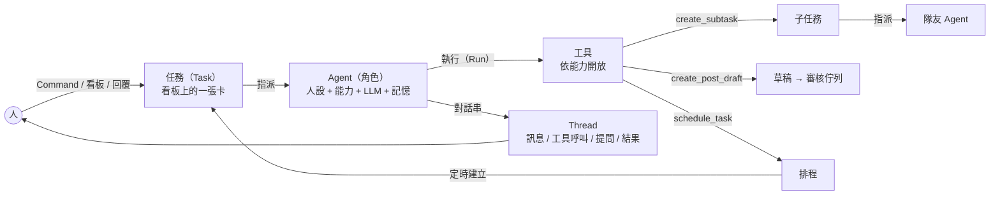
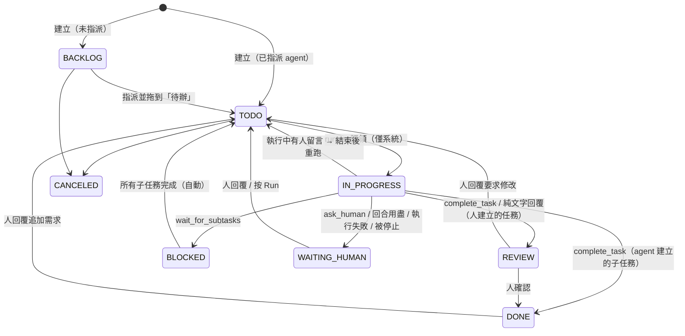
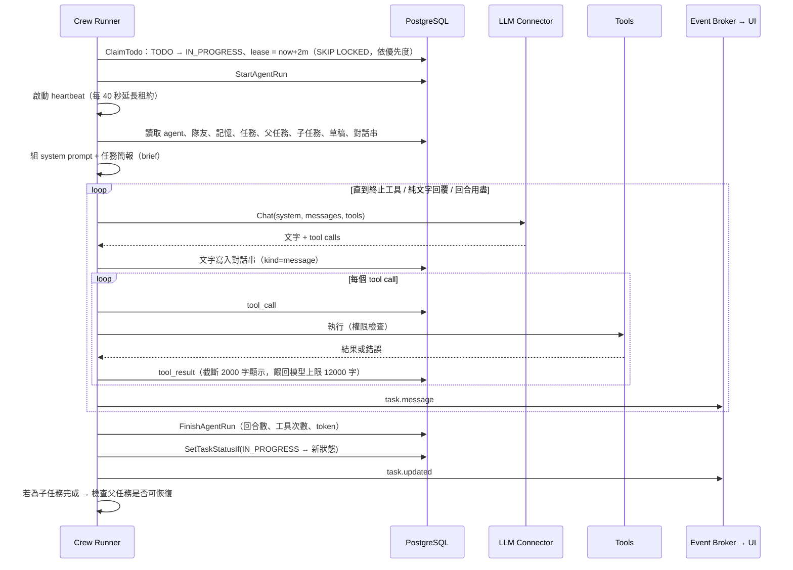
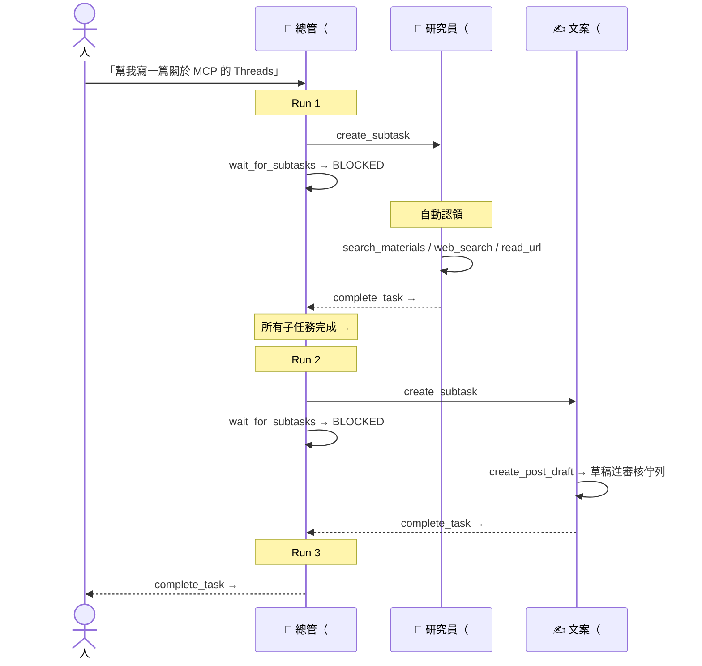

# Agentic Flow 設計

> 這份文件說明 CueFlow 的 agent 團隊怎麼理解需求、分工、執行、和人協作。
> 整體系統架構見 [architecture.md](architecture.md)；相關 API 見 [api.md](api.md) 的 Agents / Tasks / Schedules 段落。

## 1. 目標與定位

使用者用一句話交代事情（像跟 Grok bot 對話），由一組各有專長的 agent 自動完成：理解需求、拆解工作、分派給隊友、蒐集資料、寫草稿、設定定時工作，最後回報成果。整個過程攤在看板上，人可以隨時介入。

設計上有三條底線：

1. **Agent 不能發文。** 草稿一律進審核佇列，只有人能核准。這是 PRD 的 Human-in-the-loop 原則，也是安全模型的基礎。
2. **一切可見、可接手。** Agent 的每個想法、工具呼叫、結果都寫進任務對話串；人可以回覆、改指派、拖卡片、停止。
3. **有界。** 回合數、子任務、草稿數、委派深度、排程頻率都有上限，避免失控的迴圈與費用。

## 2. 核心概念

| 概念 | 說明 |
|---|---|
| **Agent（角色）** | 名稱、slug（用於 `@mention` 與委派）、頭像、角色類型、描述（給隊友看的自我介紹）、instructions（人設與長期指示）、能力、LLM／搜尋／來源 connector、語言、平台、回合上限 |
| **能力（Capability）** | 工具的權限群組。Agent 只看得到自己能力範圍內的工具 |
| **任務（Task）** | 看板上的卡片：標題、描述、狀態、優先度、標籤、指派對象、父任務、結果 |
| **對話串（Thread）** | 任務底下的訊息流，包含人和 agent 的發言、工具呼叫與結果、系統狀態、提問、最終結果 |
| **執行（Run）** | Agent 處理任務的一次工作階段；一個任務可以有多次執行（例如等待子任務後被喚醒） |
| **記憶（Memory）** | Agent 跨任務保存的筆記（偏好、事實、決定），每次執行時帶入最近 30 筆 |
| **排程（Schedule）** | cron 定時為某個 agent 建立任務 |

## 3. 預設團隊

第一次啟動且尚無任何 agent 時，系統會自動建立以下四個角色（`internal/crew/defaults.go`），之後都可以在 UI 修改或新增：

| 角色 | slug | 能力 | 職責 |
|---|---|---|---|
| 🧭 總管 | `chief` | planning, delegation, memory, research | 對外窗口：理解需求、拆解、委派、設定排程、彙整回報；回合上限 16 |
| 🔎 研究員 | `researcher` | research, memory | 蒐集與查證資訊，產出附來源的重點摘要 |
| ✍️ 文案 | `writer` | drafting, research, memory | 依平台風格寫草稿（預設 Threads + Instagram） |
| 🧐 編輯 | `editor` | drafting, memory | 檢查待審草稿的事實、語氣與規範並修稿（不能核准） |

## 4. 能力與工具

| 能力 | 工具 | 說明 |
|---|---|---|
| （全體） | `add_comment` | 在對話串發進度 |
| | `ask_human` | 提問並暫停，等人回覆（終止本次執行） |
| | `complete_task` | 回報成果並結束（終止本次執行） |
| research | `web_search` | 透過 SearXNG / Tavily 搜尋 |
| | `read_url` | 讀公開網頁（擋內網，見 §10） |
| | `search_materials` | 搜尋 RSS / 信件已收集的素材 |
| | `fetch_sources` | 立刻從來源 connector 抓最新內容 |
| drafting | `create_post_draft` | 為單一平台建立草稿，直接進 `PENDING_REVIEW` |
| | `list_posts` | 列出貼文與審核狀態 |
| | `revise_draft` | 修改仍在 `DRAFT` / `PENDING_REVIEW` 的草稿（稽核紀錄記為 agent） |
| delegation | `create_subtask` | 建立子任務並指派給隊友（立即開始） |
| | `list_agents` | 列出可委派的隊友 |
| | `wait_for_subtasks` | 暫停，等所有子任務完成後被喚醒（終止本次執行） |
| planning | `list_tasks` / `get_task` | 查看看板任務 |
| | `create_task` | 建立獨立任務（非子任務） |
| | `schedule_task` / `list_schedules` / `pause_schedule` | 管理定時任務 |
| memory | `remember` / `search_memory` | 寫入／搜尋長期記憶 |

**工具權限是三層防護：**

1. **宣告層**：送給 LLM 的工具清單只包含該 agent 能力內的工具。
2. **執行層**：模型若呼叫清單外的工具（例如被誘導呼叫 Postiz 的 `integrationSchedulePostTool`），runner 會直接回傳錯誤結果「Tool is not available to you」，並記錄在對話串。
3. **發布層**：即使未來有人誤把發布器接進 agent，agent 執行時的 context 帶有 `guard.WithAgent` 標記，`guardedPublisher` 一律拒絕。

## 5. 任務狀態機

| 狀態 | 看板欄位 | 意義 |
|---|---|---|
| `BACKLOG` | Backlog | 想法，尚未開始 |
| `TODO` | 待辦 | 準備好了；有指派 agent 的話會被自動認領 |
| `IN_PROGRESS` | 進行中 | Agent 正在執行（只能由系統設定，人不能拖進來） |
| `BLOCKED` | 等待中 | 等子任務完成 |
| `WAITING_HUMAN` | 等待中（needs you） | Agent 提問、執行失敗、或回合用盡 |
| `REVIEW` | 待確認 | Agent 完成，等人檢查成果 |
| `DONE` / `CANCELED` | 完成 / 隱藏 | 結束 |

和貼文狀態機不同，任務狀態對人是寬鬆的：看板上可以自由拖動（除了「進行中」）。嚴格的部分是 agent 結束時：只有在任務**仍是 `IN_PROGRESS`** 時才會套用新狀態（`SetTaskStatusIf`）；如果人在 agent 執行中把卡片拖走，agent 的結果會寫進對話串，但不會把卡片拉回去。

## 6. 一次執行（Run）的生命週期

### 6.1 無狀態執行

每次執行都**從頭重建上下文**，不重播上一次執行的原始 LLM 訊息：

- **System prompt**：通用工作守則 + 角色描述 + 委派守則與隊友名單（有 delegation 能力時）+ 排程守則（有 planning 時）+ 該角色的 instructions + 最近 30 筆記憶 + 目前時間。
- **任務簡報（第一則 user 訊息）**：任務標題、優先度、標籤、期限、描述、父任務、所有子任務與其結果、已產生的草稿，以及對話串最近 60 則（工具結果壓縮到 500 字）。

好處：
- 跨 provider 無痛：不需要保存各家 LLM 的原生訊息格式；同一個任務中途換 LLM 或換 agent 都能接著做。
- 人在對話串的回覆、隊友的子任務結果、系統訊息，自然成為下一次執行的上下文。
- 單次執行內仍保留原生格式（例如 Anthropic 的 thinking block 會原樣回傳），工具迴圈不會失真。

### 6.2 結束條件與狀態對應

| 結束原因 | 寫入對話串 | 新狀態 | 執行紀錄 |
|---|---|---|---|
| `complete_task` | `result` | 人建立的任務 → `REVIEW`；agent 建立的子任務 → `DONE` | SUCCEEDED |
| 純文字回覆（沒有呼叫工具） | `result` | 同上（視為完成，適合問答類任務） | SUCCEEDED |
| `ask_human` | `question` | `WAITING_HUMAN` | SUCCEEDED |
| `wait_for_subtasks` | 系統訊息 | `BLOCKED`（若子任務其實都已完成則立即回到 `TODO`） | SUCCEEDED |
| 回合用盡 | 系統訊息（說明可回覆繼續或調高上限） | `WAITING_HUMAN` | FAILED |
| LLM／設定錯誤 | 系統訊息（含錯誤原因） | `WAITING_HUMAN` | FAILED |
| 被人停止 | 「Stopped.」 | `WAITING_HUMAN` | CANCELED |
| 程序重啟、租約過期 | 系統訊息（說明中斷） | `WAITING_HUMAN` | FAILED |

**執行中有人留言**：runner 不會打斷正在跑的 LLM 呼叫，而是在結束時檢查「本次執行開始後是否有人類訊息」。如果有，就不套用完成狀態，改回 `TODO` 立即重跑，讓新的留言被處理（被停止或失敗時除外）。

## 7. 委派與恢復

規則：

- 子任務一建立就是 `TODO` 並已指派，runner 會立即認領，同時最多 3 個任務並行（`CUEFLOW_AGENT_CONCURRENCY`）。
- 父任務呼叫 `wait_for_subtasks` 後進入 `BLOCKED`。之後只要任一子任務進入 `DONE` / `REVIEW` / `CANCELED`（不論是 agent 完成還是人在看板上拖的），系統就會檢查是否所有子任務都已結束；是的話，把子任務結果摘要寫進父任務對話串，並將父任務移回 `TODO`。
- 子任務若卡在 `WAITING_HUMAN`（例如研究員有問題要問），父任務會一直保持 `BLOCKED`，直到人處理完。
- 委派最多 3 層（根任務 → 子任務 → 孫任務），孫任務不能再往下委派。

## 8. 人機協作

| 人的動作 | 系統行為 |
|---|---|
| 在 Command 送出需求 | 建立指派給所選 agent（預設總管）的 `TODO` 任務，開啟任務頁 |
| 在看板新增卡片並指派 | 指派了 agent 就從 `TODO` 開始，否則進 `BACKLOG` |
| 把卡片拖到「待辦」 | 有指派 agent 就自動開始 |
| 在對話串留言 | 任務有 agent 且不在 `BACKLOG` / `CANCELED` → 移到 `TODO`，agent 讀到留言後繼續；若正在執行中，結束後自動重跑 |
| 留言以 `@slug` 開頭 | 先把任務轉給該 agent（正在執行的會被停止），再照上一列處理 |
| 按「Stop」或把執行中的卡片拖走 | 取消該次執行的 context，LLM 呼叫中止，任務停在 `WAITING_HUMAN` 或你拖到的欄位 |
| 改派給別的 agent | 正在執行的會被停止 |
| 審核草稿 | Agent 產生的草稿與一般草稿一樣，在 Review 頁核准後才會交給 Postiz |

## 9. 排程

- 人在 Schedules 頁建立，或由具備 planning 能力的 agent 透過 `schedule_task` 建立（標記 `created_by: agent`，UI 會顯示「由 agent 建立」）。
- 每次觸發建立一個新任務：標題加上日期、帶 `scheduled` 標籤、指派給設定的 agent，並立即喚醒 runner。
- 驗證：合法的 5 欄位 cron 或 `@daily` 等描述子；連續觸發間隔必須 ≥ 5 分鐘（用接下來 5 次觸發時間檢查），避免 agent 建出每分鐘跑一次的排程。驗證失敗時，錯誤會回給 agent，讓它自行修正。
- `Run now` 可以立即產生一次任務。

## 10. 防護與上限

| 項目 | 上限／行為 | 位置 |
|---|---|---|
| 每次執行回合數 | 角色設定 `max_turns`（預設 12，總管 16，最高 40） | `store/agents.go` |
| 每次執行建立的子任務 + 獨立任務 | 8 | `crew/tools.go` |
| 每次執行建立的草稿 | 10 | `crew/tools.go` |
| 委派深度 | 3 層 | `crew/tools.go` |
| 餵回模型的單一工具結果 | 12,000 字（顯示在對話串時截斷為 2,000 字） | `crew/crew.go` |
| 任務簡報帶入的對話 | 最近 60 則 | `crew/prompt.go` |
| 帶入的記憶 | 最近 30 筆，單筆 2,000 字 | `crew/crew.go`、`store/agents.go` |
| 排程頻率 | ≥ 5 分鐘 | `scheduler.ValidateSchedule` |
| 並行任務 | 3（`CUEFLOW_AGENT_CONCURRENCY`） | `config` |
| 執行租約 | 2 分鐘，每 40 秒續約；過期 → `WAITING_HUMAN` | `crew/crew.go` |
| `read_url` | 只允許 http(s)；連線時擋 loopback / 私有 / link-local / CGNAT / multicast；最多 5 次重新導向；2 MB、8,000 字、30 秒；不走系統 proxy（`CUEFLOW_AGENT_ALLOW_PRIVATE_URLS=true` 可放寬） | `crew/fetch.go` |
| 發布 | 任何 agent 都做不到，見 §4 | `guard`、`connector` |

## 11. 提示詞設計

System prompt 由程式組合，順序固定：

1. **身分與工作守則**：你是誰、正在處理任務 #N、自主推進、必要時才問人、不能發文、事實必須有來源、長任務要回報進度、結束時用 `complete_task` 總結、用指定語言溝通。
2. **委派守則與隊友名單**（有 delegation 能力時）：每位隊友的 slug、角色、描述與能力，引導「交給專家，但不要為瑣事開子任務」，完成前要檢查子任務成果。
3. **排程守則**（有 planning 能力時）：週期性需求用排程而不是只做一次，並推斷合適的時區。
4. **角色 instructions**：使用者在 UI 編輯的人設與長期指示。
5. **記憶**、**目前時間**。

角色之間的差異全部來自「能力（決定看得到哪些工具）」加上「instructions（決定怎麼做）」，因此新增一個角色（例如「數據分析師」或「客服回覆員」）不需要改程式。

## 12. 端到端範例

使用者在 Command 輸入：「每天早上 8 點整理 AI 新聞並寫成 Threads 草稿」。

1. 建立任務 #1，指派總管，狀態 `TODO`。
2. **總管 Run 1**：判斷這是週期性需求，但時間點不明確時會 `ask_human`；這裡已經說了 8 點，所以直接 `schedule_task`（`0 8 * * *`、`Asia/Taipei`，指派文案，描述寫清楚要蒐集前一天的 AI 新聞並寫草稿），再用 `remember` 記住「使用者偏好每天 8 點收 AI 新聞草稿」，最後 `complete_task` 回報設定了什麼。#1 → `REVIEW`。
3. 隔天 08:00：排程建立任務 #2「整理 AI 新聞寫成 Threads 草稿 · 2026-10-05」，指派文案，自動開始。
4. **文案 Run**：`fetch_sources` → `search_materials` → 需要時 `web_search` / `read_url` 查證 → `create_post_draft`（Threads，超過 500 字會自動拆成串文）→ `complete_task` 回報草稿 ID。#2 → `REVIEW`。
5. 你在 Review 頁看到草稿，修改後核准 → 發布 worker 交給 Postiz 發出。
6. 想調整風格時，直接在 #2 留言「語氣再犀利一點，結尾加問題」，文案會重跑並用 `revise_draft` 修改尚未核准的草稿；或者用 `@editor 幫我檢查` 把任務轉給編輯。

## 13. 已知限制與後續方向

- **成本控管**：目前以回合與數量上限控管，尚未有以 token 或金額計算的預算上限；`agent_runs` 已記錄 token 用量，可作為後續做每日預算的基礎。
- **長任務壓縮**：上下文採「最近 60 則」截斷，非常長的任務可能遺失早期細節；可以改成由 agent 自己寫階段摘要。
- **結構化產出**：子任務結果目前是自由文字；要做資料管線時可加上 JSON schema 輸出。
- **外部 MCP 工具**：`internal/mcpx` 已提供工具分類（擋掉具副作用的工具），之後可以讓 agent 使用唯讀的第三方 MCP 工具。
- **單實例**：cron 不適合多實例部署（見 architecture.md §8）。
