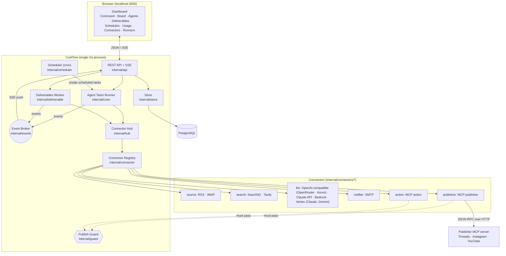
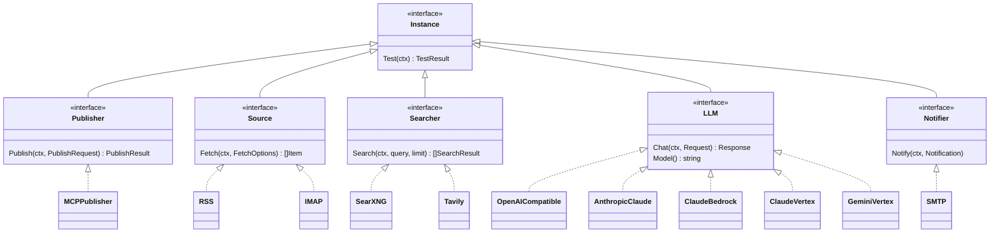
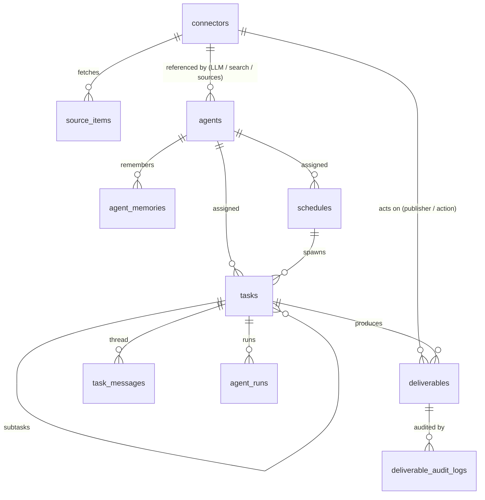
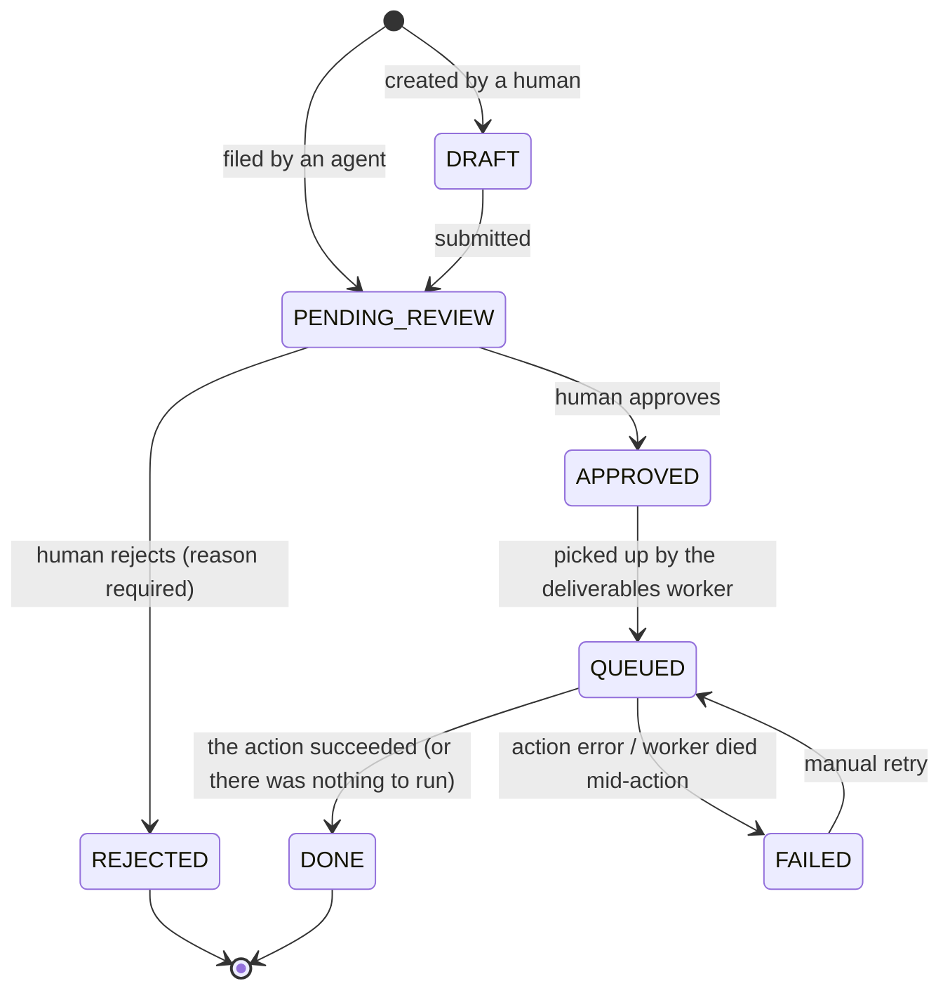
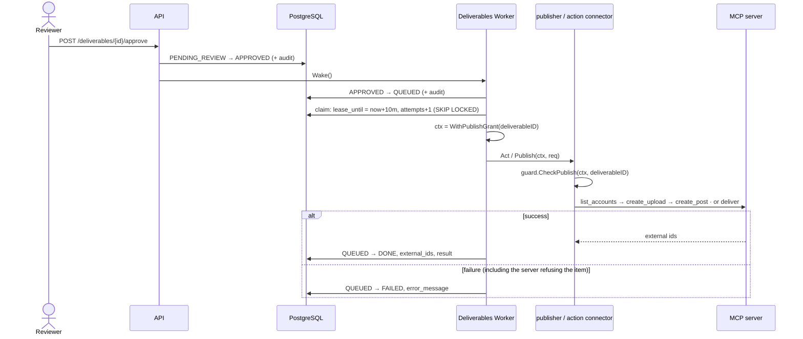
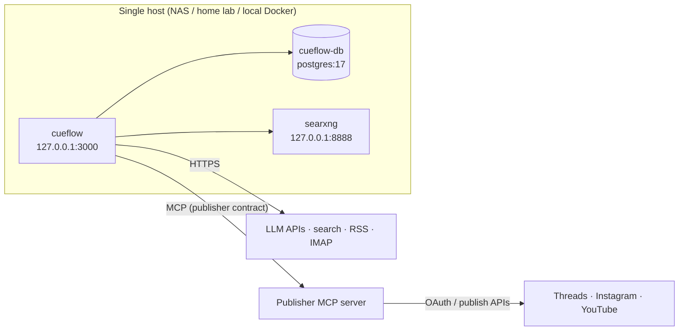

# CueFlow Architecture

> Traditional Chinese version: [docs/zh-TW/architecture.md](zh-TW/architecture.md)

> Audience: developers who deploy, operate or extend CueFlow. For how the agent team works see
> [agentic-flow.md](agentic-flow.md); for the REST interface see [api.md](api.md); for plugin development see
> [connectors.md](connectors.md).

## 1. Goals and principles

| Principle | How the architecture implements it |
|---|---|
| **Human-in-the-loop first** | Every deliverable (a post, a document...) follows a strict state machine; only a human can move one to `APPROVED`; publishers and action connectors are wrapped in an authorization check so only the deliverables worker can call them, and only for that one approved item |
| **Zero public exposure** | Everything is outbound polling (RSS / IMAP / MCP calls), no webhooks needed; binds to `127.0.0.1:3000` by default |
| **Protocol-driven** | The core depends on no social platform SDK; publishing goes through MCP to a publisher server that owns the platforms, and that publisher is just a connector plugin |
| **Everything is a plugin** | Publishers, sources, search, LLMs and notifiers are all connectors sharing one registration / configuration / encryption mechanism |
| **One process, easy to deploy** | A single Go binary (API + scheduler + deliverables worker + agent runner) with the static frontend embedded; the only external dependency is PostgreSQL |
| **Observable and auditable** | Every deliverable status change and human edit is written to `deliverable_audit_logs`; every agent step is written to the task thread and `agent_runs` |

## 2. System overview



### 2.1 Package responsibilities

| Package | Responsibility |
|---|---|
| `cmd/cueflow` | Entry point: load config, connect to the DB, run migrations, wire all components, graceful shutdown; subcommands `migrate` / `genkey` / `healthcheck` / `rotate-key` / `runner` / `media` / `mcp-bridge` |
| `cmd/mock-publisher-mcp` | A publisher MCP server that posts nowhere, for development and demos (`internal/publishermock`) |
| `internal/config` | Load settings from environment variables (`CUEFLOW_*`, `DATABASE_URL`) |
| `internal/db` | Connection pool, embedded SQL migrations (an advisory lock prevents concurrent migrations from multiple instances) |
| `internal/domain` | The errors every layer shares (`ErrNotFound`, `ErrVersionConflict`, `TransitionError`) |
| `internal/store` | All PostgreSQL access; status changes and audit entries are written in the same transaction |
| `internal/secret` | AES-256-GCM encryption of connector secret fields |
| `internal/connector` | Plugin registry, config schema, the five kind interfaces, the publisher authorization wrapper |
| `internal/connectors/*` | Built-in plugin implementations |
| `internal/hub` | Loads a connector from the DB, decrypts it and calls its factory to build an instance |
| `internal/mcpx` | MCP client wrapper (Streamable HTTP / SSE / stdio), tool classification |
| `internal/guard` | Publish authorization (a grant and an agent marker carried on the context) |
| `internal/llm` | Provider-neutral chat types used by the tool loops; LLM connectors translate to their wire formats |
| `internal/crew` | Agent team runner: task claiming, tool loop, delegation, schedules, memory; the capability/tool registry modules add to |
| `internal/content` | The social content module on deliverables: the `post` kind (platform rules as validation, publishing through a publisher connector as its action), source items, publisher accounts and the drafting tools; mounted on the core through `api.Module` and the crew registry |
| `internal/deliverable` | The deliverables module: typed items (kinds with payload validation) any agent can produce, one review state machine with an audit log, and a worker that, after approval, runs the kind's own action (a post is published) or an action connector, under a grant |
| `internal/scheduler` | cron: spawns scheduled tasks and fires the cron rows and periodic jobs modules register |
| `internal/events` | Pub/sub for live SSE updates, fanned out through PostgreSQL `LISTEN/NOTIFY` |
| `internal/jobs` | Background work requests ("run this task", "fire this schedule", plus the kinds modules register): in-process locally, Cloud Tasks in cloud mode (`internal/jobs/cloudtasks`) |
| `internal/acpx` / `internal/acpdrive` | Launches ACP agents over stdio; drives one prompt through one under CueFlow's sandbox policy; shared by the server and runners |
| `internal/runner` / `internal/runnerapi` | `cueflow runner register\|run\|status` (the machine side of Runners) and the wire protocol |
| `internal/blob` | Byte storage for media outside the database (`file://`, `gcs://` with signed URLs); rows record which backend holds them |
| `internal/media` | Type and size checks, uploads, image generation, the `/media/{id}` references publishers receive |
| `internal/internalauth` / `internal/googleid` | Verifies the Google-signed tokens on `/internal/*`; signs CueFlow's own calls to private Cloud Run services |
| `internal/cfaccess` | Recognizes requests that passed Cloudflare Access (the dashboard login in the cloud) |
| `internal/textutil` | Thread splitting and HTML rendering for publishers |
| `internal/api` | REST + SSE, admin token check, serves the embedded frontend |
| `internal/webui` | Embedded Next.js static export (`web/out` → `internal/webui/dist`) |
| `web/` | Next.js + Tailwind frontend (static export) |

### 2.2 Background loops

A CueFlow process runs three kinds of background work, which communicate only through database state:

| Loop | Frequency | What it does |
|---|---|---|
| Scheduler | cron expressions | Creates tasks from schedules; fires the cron rows and periodic jobs modules register |
| Deliverables Worker | every 3 seconds (`CUEFLOW_DISPATCH_INTERVAL`), or woken immediately after an approval or a retry | Acts on approved deliverables: publishes a post, runs the action connector |
| Crew (agent runner) | every 2 seconds, or woken immediately when there is a new task | Claims `TODO` tasks and lets agents work them, 3 at a time by default |

"Waking" is a non-blocking channel notification, so work starts almost immediately after an approval or an assignment; the periodic polling is only a safety net.

### 2.3 Where an agent's work runs

An agent's runtime decides who executes its tasks. The tool server, thread and outcomes are the same in every case, so
review, permissions and "agents never publish" do not depend on the runtime.

| Runtime | Who decides what to do | Who executes |
|---|---|---|
| Built-in (no runtime connector) | CueFlow's agent loop | CueFlow, calling the LLM connector |
| `acp_agent` | CueFlow | An ACP agent CLI launched on the CueFlow host |
| `runner_pool` | CueFlow | An ACP agent CLI on a registered **Runner** |
| `external` (self-driven) | The agent itself | The agent itself, over MCP with an agent token |

**Runners.** For a `runner_pool` agent the crew claims the task as usual, registers the per-run MCP tool server, and
inserts a `runner_jobs` row (labels, prompt, the tool server's path). A runner polls `/api/runner/v1/jobs/claim` (every 20 s, answered at once: a request held open is what Cloud Run bills, so a long-polling runner kept the service billed all day);
the claim is `FOR UPDATE SKIP LOCKED` and matches labels (`job.labels <@ runner.labels`) and org. The runner launches the
agent locally, the agent calls CueFlow's MCP tools directly, and the runner streams thread events and heartbeats (a
2-minute lease). When a terminal tool (`complete_task`, `ask_human`...) ends the task the server moves the job to
`canceling`; the runner's next heartbeat tells it to stop, it reports the tail of the conversation and completes the job.
A job nobody claims within `queue_timeout_minutes`, or whose runner stops heartbeating, fails the task.
Runner and agent tokens are stored as SHA-256 only.

**Self-driven agents.** The claim loop skips agents whose runtime is `external`. They claim tasks through the agent-token
MCP endpoint (`ClaimTaskForAgent`: `TODO → IN_PROGRESS` with a 30-minute lease, extended by every call); the crew's
lease recovery returns a quiet task to `TODO`.

## 3. Connector plugin model



One plugin = one package that calls `connector.Register(spec, factory)` in `init()`:

- **Spec**: type name, kind, field list (type, required, default, secret). The frontend generates the config form from the Spec; `/api/v1/meta` returns all Specs.
- **Factory**: receives settings that are already validated, defaulted and decrypted, plus an `Env` (logger, HTTP client, state store), and returns an instance.
- **Build flow**: `hub.Instance(id)` → read from DB → decrypt secrets → `Spec.WithDefaults` → `Spec.Validate` → factory → check the instance really implements the kind's interface → if it is a publisher, **wrap it in `guardedPublisher`**.

Adding an integration needs no core changes: add a package and one blank import in `internal/connectors/all`.

## 4. Data model



| Table | Key design points |
|---|---|
| `connectors` | Plain settings in `config` (JSONB, displayable); secret fields encrypted into `secrets` (BYTEA); `state` lets plugins store a cursor |
| `source_items` | `UNIQUE(connector_id, external_id)` gives delta fetching (GUID for RSS, Message-ID for mail); `consumed_at` keeps the same item from being written up twice |
| `deliverables` | `kind`, JSON `payload`, status, `version` (optimistic locking), `lease_until` / `attempts` (action lease), `external_ids` / `result` (what the action returned), `action_connector_id`, `task_id` (provenance) |
| `deliverable_audit_logs` | Every status change and edit (with payload diffs) |
| `agents` / `agent_memories` | Role configuration and long-term memory |
| `tasks` / `task_messages` / `agent_runs` | Board tasks, threads, and per-run turn and token counts |
| `schedules` | cron settings that create tasks |

Migrations live in `internal/db/migrations/` and are applied automatically at startup. `posts`, `pipelines`,
`pipeline_runs` and `audit_logs` are left over from the earlier posts path: nothing reads or writes them, they
only keep the history of installations that used it.

## 5. Deliverable lifecycle and acting on approval

A deliverable is anything an agent produces that a human must approve before the system acts: a `post`
(content module) or a `document` (built in), each a *kind* with its own payload validation. The content
module's post is the case the mechanism was derived from.

### 5.1 State machine



- Transitions are defined in exactly one place, `internal/deliverable/deliverable.go`; anything not in the table returns `invalid_transition`.
- Only `DRAFT` / `PENDING_REVIEW` items can be edited; edits must carry `version`, and a stale version returns `409`.
- Each transition and its audit entry (`deliverable_audit_logs`) are written in **the same transaction**.

### 5.2 What approval leads to

Approval ends the review and starts exactly one action, run by the deliverables worker (`internal/deliverable/worker.go`):

| Kind | Action after approval |
|---|---|
| `post` | The content module's `Act`: publish through the publisher connector named on the item (or the org's first active one), to the accounts picked in the editor |
| `document` (and any kind without its own `Act`) | The org's action connector (`mcp_action`, tool `deliver`), named on the item or the first active one; with no action connector the item is `DONE` as soon as it is approved: the review itself was the point |



### 5.3 Preventing duplicate actions

The worker takes a lease (`lease_until`, length `CUEFLOW_DISPATCH_LEASE`) before acting. If it dies mid-action and the lease expires, the item is marked `FAILED` on the next sweep with a note that the action "may or may not have happened; check before retrying". It is **never retried automatically**: we cannot know whether the publisher already received it, so an automatic retry could double-post. A human retries from the Deliverables page (`FAILED → QUEUED`).

### 5.4 Agents and deliverables

Agents never approve and never publish. The `post_deliverables` capability ("Drafting" in the UI) gives `create_post_draft` / `list_posts` / `revise_draft`, which write `post` deliverables; the `deliverables` capability gives the generic create / list / revise for any registered kind. Both file items as `PENDING_REVIEW` under the agent's name, and a task's deliverables are listed on its card. Recurring drafting is an ordinary schedule: a cron expression that creates a task for the writer agent (see [agentic-flow.md](agentic-flow.md)).

## 6. Security model

| Threat | Mitigation |
|---|---|
| An LLM hallucinates or is prompt-injected into publishing directly | No agent tool can publish; agent runs carry a context marker that `guardedPublisher` / `guardedActor` reject; publishing or acting requires a grant issued by the deliverables worker for **that specific deliverable** |
| External material (RSS, web pages) carries injected instructions | Same as above: the worst case is a draft waiting for review; every agent action is written to the thread and traceable |
| An agent is steered into the internal network (SSRF) | `read_url` checks the resolved IP at dial time and blocks loopback, private ranges, link-local (including cloud metadata `169.254.169.254`) and CGNAT; redirects are re-checked; the system proxy is bypassed |
| A database leak exposes credentials | Connector secret fields are AES-256-GCM encrypted with the connector ID as associated data (a ciphertext moved to another row will not decrypt); the API never returns secret values |
| Unauthorized access to the console | Binds to localhost by default; `CUEFLOW_ADMIN_TOKEN` can require a Bearer token (compared in constant time) |
| External agents driving the board over MCP | `/mcp` is off unless `CUEFLOW_MCP_TOKEN` is set; it can manage tasks but has no tool that approves or acts on deliverables |
| An agent runs away creating tasks or spending money | Per-run caps on turns, subtasks, drafts and delegation depth; schedules fire at most every 5 minutes (see agentic-flow.md) |
| A worker crash causes a duplicate post or action | Leases, see 5.3 |

## 7. Live updates

`internal/events` is a pub/sub whose events travel through PostgreSQL `LISTEN/NOTIFY` (one dedicated listening connection per process, reconnecting on failure), so a second CueFlow instance on the same database delivers every event to its own browsers too. Every state change (deliverables, tasks, threads, runs, connectors, agents, schedules, orgs, runners) publishes an event; each event names its org (or none, for global changes such as connectors), `GET /api/v1/events?org=` pushes a tab only its own org's events and the global ones over SSE, and the frontend refetches the affected data. Slow subscribers drop events instead of blocking the system, and the frontend refetches everything on reconnect, so nothing relies on guaranteed delivery.

## 8. Deployment topology



- `deploy/docker-compose.yml`: `cd deploy && docker compose up -d` brings up every service; all ports are bound to `127.0.0.1`. For remote access use an SSH tunnel or Tailscale.
- The CueFlow image is distroless and non-root, with a built-in `healthcheck` subcommand.
- For development or a trial run, `--profile mock` starts a mock publisher MCP server that posts nowhere.
- The local deployment is **single-instance**: in-process loops, in-process cron. Task and publish claiming use database leases and `SKIP LOCKED`, so two instances would not process the same work twice, but cron would fire once per instance. For several instances use the cloud mode below.

### 8.1 Cloud deployment (Cloud Run + Cloud Tasks + Cloud Scheduler)

The same binary and image run in the cloud with `CUEFLOW_QUEUE=cloudtasks` and `CUEFLOW_TICK=external` (guide: `deploy/cloudrun/`). Nothing polls and nothing is scheduled in the process, so it scales to zero between requests and runs on several instances:

```
 Cloud Scheduler ── every minute ──► POST /internal/tick
        claims due schedules and the modules' cron rows (next_run_at), sweeps abandoned work, enqueues what is waiting

 user / agent action ─► cueflow ── writes DB ── Wake() ──► Cloud Tasks ──► POST /internal/work/{crew|schedule|approval|deliver}/{id}
                                                                          claim atomically, do the work, return
 /api/runner/*, /mcp/run/{token}: served by any instance (credentials and outcomes live in the database)
```

| Concern | How it works |
|---|---|
| Work delivery | `jobs.Queue` (`internal/jobs`): `Wake()` on the crew and the deliverables worker enqueues a delivery; `internal/jobs/cloudtasks` posts it to Cloud Tasks over REST. Delivery is at least once; every handler starts with an atomic claim, so duplicates find nothing to do. Handlers claim *whichever work is next* (the id is for naming and de-duplication), loop until none is left, and stop after 25 minutes, re-enqueueing if work remains |
| The clock | `Scheduler.Tick` uses `next_run_at` on schedules and on the cron tables modules register (`store.ClockTables`). Due rows are claimed with `FOR UPDATE SKIP LOCKED` and moved forward in one transaction, so concurrent ticks fire an activation once. A row without `next_run_at` (new or edited) is only scheduled; an activation more than 15 minutes late is skipped |
| Cleanup | The start-up "everything running is stale" cleanup is skipped in the cloud; `Store.FailAbandoned` on the tick closes work whose lease or age shows its owner is gone |
| Per-run MCP | The run's token is a row in `run_tokens`; any instance rebuilds the tool server from it. A terminal tool call writes its outcome there and the waiting instance polls it, so the call may be served elsewhere |
| Cancel | The running instance's heartbeat cancels the run when its task is no longer `IN_PROGRESS`, so a cancel on any instance takes effect within one lease interval |
| Internal endpoints | `/internal/*` exists only in cloud mode and requires a Google-signed ID token with the configured audience from an allow-listed service account (`internal/internalauth`) |
| Events | PostgreSQL `LISTEN/NOTIFY` (see §7): every instance pushes every event to its own browsers. Use a session pooler, not a transaction pooler, for the database |
| Media | `gcs://bucket/prefix` (`internal/blob`): `/media/{id}` answers 302 to a short-lived signed URL (IAM-signed, no key file) |
| Agents | Only runners and self-driven agents (`runner_pool`, `external`): the cloud has no agent CLI. Built-in LLM agents work as usual |

Not covered by automated tests (they need a real project): the Cloud Tasks and Cloud Scheduler calls, IAM signing and real ID-token validation. These are tested against fakes.

## 9. Extension points

| What you want to do | Where to change |
|---|---|
| Add a publishing channel, source, search engine, LLM or notifier | Add a connector plugin ([connectors.md](connectors.md)) |
| Add platform rules (character limits, hashtag caps) | `internal/content/platform.go` |
| Give agents a new tool | Core tools in `internal/crew/tools.go`; a module registers its own with `crew.RegisterCapability` / `crew.RegisterTool` (see `internal/content/tools.go`). Never add a tool that can publish |
| Add a default role | `internal/crew/defaults.go` |
| Change the agents' working rules | `internal/crew/prompt.go` (all agents) or edit one role's instructions in the UI |
| Add a table | `internal/db/migrations/000N_*.sql` |
