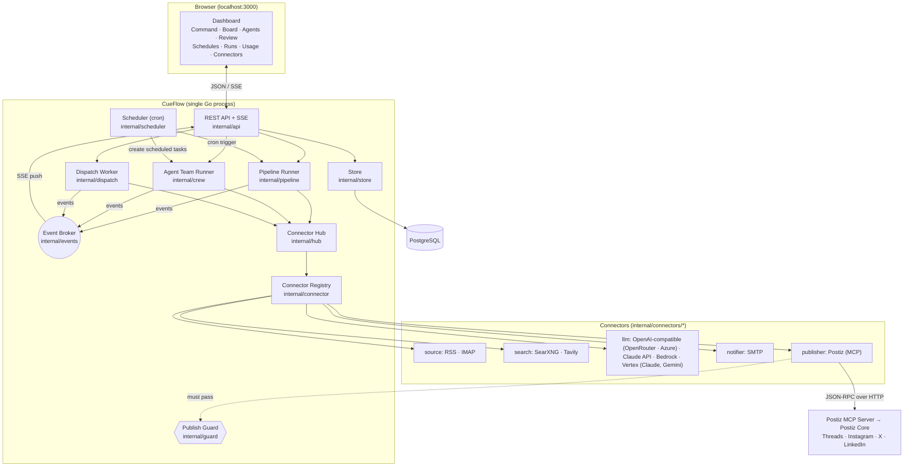
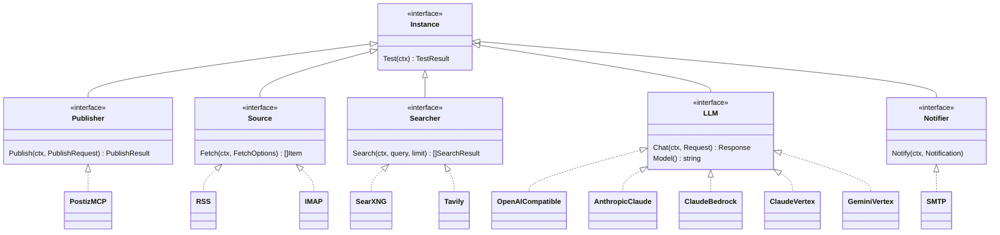
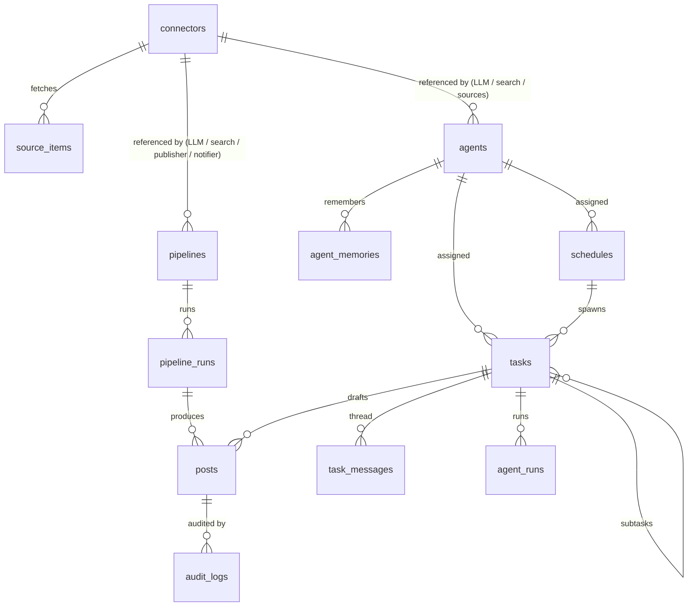
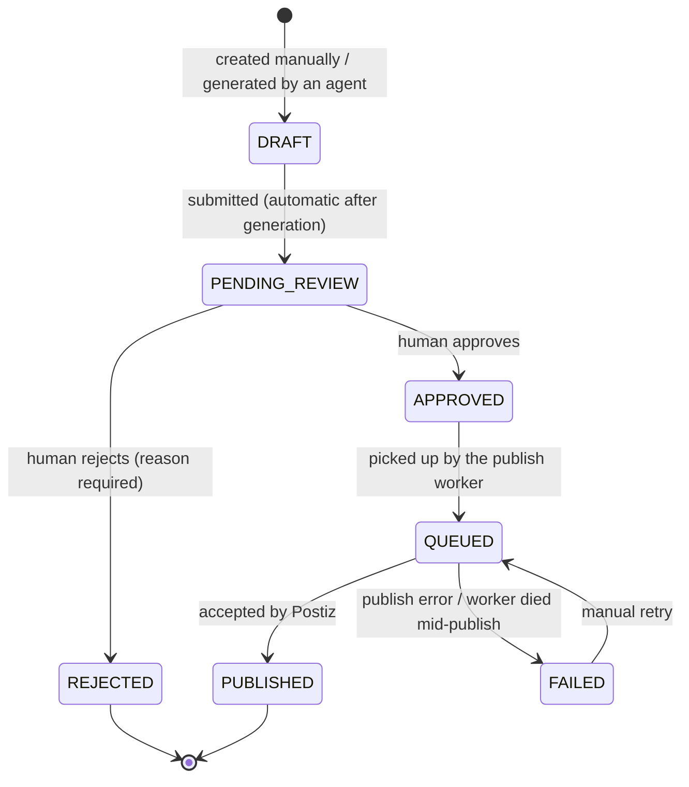
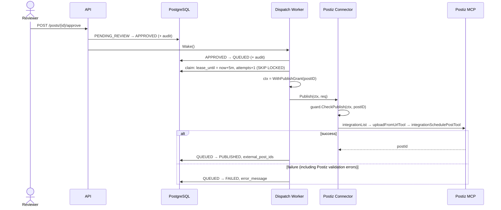
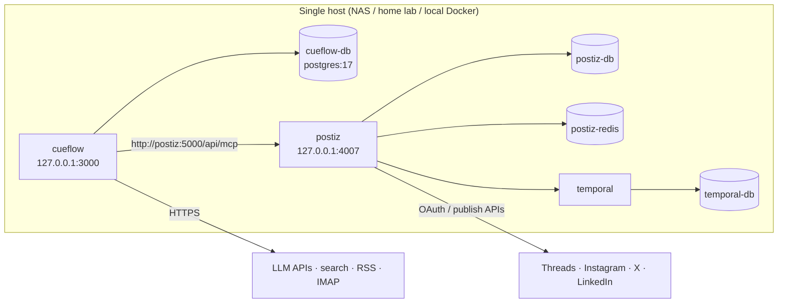

# CueFlow Architecture

> Traditional Chinese version: [docs/zh-TW/architecture.md](zh-TW/architecture.md)

> Audience: developers who deploy, operate or extend CueFlow. For how the agent team works see
> [agentic-flow.md](agentic-flow.md); for the REST interface see [api.md](api.md); for plugin development see
> [connectors.md](connectors.md).

## 1. Goals and principles

| Principle | How the architecture implements it |
|---|---|
| **Human-in-the-loop first** | Every post follows a strict state machine; only a human can move a post to `APPROVED`; publishers are wrapped in an authorization check so only the dispatch worker can call them, and only for that one approved post |
| **Zero public exposure** | Everything is outbound polling (RSS / IMAP / MCP calls), no webhooks needed; binds to `127.0.0.1:3000` by default |
| **Protocol-driven** | The core depends on no social platform SDK; publishing goes through MCP to Postiz, and Postiz itself is just a connector plugin |
| **Everything is a plugin** | Publishers, sources, search, LLMs and notifiers are all connectors sharing one registration / configuration / encryption mechanism |
| **One process, easy to deploy** | A single Go binary (API + scheduler + publish worker + agent runner) with the static frontend embedded; the only external dependency is PostgreSQL |
| **Observable and auditable** | Every post status change and human edit is written to `audit_logs`; every agent step is written to the task thread and `agent_runs` |

## 2. System overview

### 2.1 Package responsibilities

| Package | Responsibility |
|---|---|
| `cmd/cueflow` | Entry point: load config, connect to the DB, run migrations, wire all components, graceful shutdown; subcommands `migrate` / `genkey` / `healthcheck` |
| `internal/config` | Load settings from environment variables (`CUEFLOW_*`, `DATABASE_URL`) |
| `internal/db` | Connection pool, embedded SQL migrations (an advisory lock prevents concurrent migrations from multiple instances) |
| `internal/domain` | Post state machine, platform rules (character limits, hashtags, thread support, media requirement) |
| `internal/store` | All PostgreSQL access; status changes and audit entries are written in the same transaction |
| `internal/secret` | AES-256-GCM encryption of connector secret fields |
| `internal/connector` | Plugin registry, config schema, the five kind interfaces, the publisher authorization wrapper |
| `internal/connectors/*` | Built-in plugin implementations |
| `internal/hub` | Loads a connector from the DB, decrypts it and calls its factory to build an instance |
| `internal/mcpx` | MCP client wrapper (Streamable HTTP / SSE / stdio), tool classification |
| `internal/guard` | Publish authorization (a grant and an agent marker carried on the context) |
| `internal/agent` | Draft generator used by pipelines (an LLM loop with two fixed tools) |
| `internal/crew` | Agent team runner: task claiming, tool loop, delegation, schedules, memory |
| `internal/pipeline` | Scheduled content pipeline: collect → generate → store for review → notify |
| `internal/dispatch` | Publish worker: `APPROVED → QUEUED → PUBLISHED / FAILED` |
| `internal/scheduler` | cron: triggers pipelines, spawns scheduled tasks, sends the review digest |
| `internal/events` | In-process pub/sub for live SSE updates |
| `internal/api` | REST + SSE, admin token check, serves the embedded frontend |
| `internal/webui` | Embedded Next.js static export (`web/out` → `internal/webui/dist`) |
| `web/` | Next.js + Tailwind frontend (static export) |

### 2.2 Background loops

A CueFlow process runs four kinds of background work, which communicate only through database state:

| Loop | Frequency | What it does |
|---|---|---|
| Scheduler | cron expressions | Triggers pipeline runs; creates tasks from schedules; (optional) sends the review digest |
| Pipeline Runner | when triggered | One full "collect → generate → pending review" pass, capped at 30 minutes |
| Dispatch Worker | every 3 seconds, or woken immediately after an approval | Sends approved posts for publishing |
| Crew (agent runner) | every 2 seconds, or woken immediately when there is a new task | Claims `TODO` tasks and lets agents work them, 3 at a time by default |

"Waking" is a non-blocking channel notification, so work starts almost immediately after an approval or an assignment; the periodic polling is only a safety net.

## 3. Connector plugin model

One plugin = one package that calls `connector.Register(spec, factory)` in `init()`:

- **Spec**: type name, kind, field list (type, required, default, secret). The frontend generates the config form from the Spec; `/api/v1/meta` returns all Specs.
- **Factory**: receives settings that are already validated, defaulted and decrypted, plus an `Env` (logger, HTTP client, state store), and returns an instance.
- **Build flow**: `hub.Instance(id)` → read from DB → decrypt secrets → `Spec.WithDefaults` → `Spec.Validate` → factory → check the instance really implements the kind's interface → if it is a publisher, **wrap it in `guardedPublisher`**.

Adding an integration needs no core changes: add a package and one blank import in `internal/connectors/all`.

## 4. Data model

| Table | Key design points |
|---|---|
| `connectors` | Plain settings in `config` (JSONB, displayable); secret fields encrypted into `secrets` (BYTEA); `state` lets plugins store a cursor |
| `source_items` | `UNIQUE(connector_id, external_id)` gives delta fetching (GUID for RSS, Message-ID for mail); `consumed_at` keeps the same item from being written up twice |
| `pipelines` / `pipeline_runs` | Scheduled content pipelines and per-run stats and step logs |
| `posts` | Status, thread parts, hashtags, media, `version` (optimistic locking), `lease_until` (publish lease), `external_post_ids`, `task_id` / `run_id` (provenance) |
| `audit_logs` | Every status change and edit (with before/after diffs); `seq` preserves order within one transaction |
| `agents` / `agent_memories` | Role configuration and long-term memory |
| `tasks` / `task_messages` / `agent_runs` | Board tasks, threads, and per-run turn and token counts |
| `schedules` | cron settings that create tasks |

Migrations live in `internal/db/migrations/` and are applied automatically at startup.

## 5. Post lifecycle and publishing

### 5.1 State machine

- Transitions are defined in exactly one place, `internal/domain/post.go`; anything not in the table returns `invalid_transition`.
- Only `DRAFT` / `PENDING_REVIEW` posts can be edited; edits must carry `version`, and a stale version returns `409`.
- Each transition and its audit entry are written in **the same transaction**.

### 5.2 Publish flow

### 5.3 Preventing duplicate posts

The worker takes a lease (`lease_until`) before publishing. If it dies mid-publish and the lease expires, the post is marked `FAILED` on the next start with a note that it "may have been published; check the platform before retrying". It is **never retried automatically**: we cannot know whether Postiz already received it, so an automatic retry could double-post.

### 5.4 Simple schedules (pipelines)

The dashboard shows pipelines as **simple schedules** on the Schedules page, next to agent-task schedules;
the API and tables keep the name `pipelines`. A pipeline is a simpler, more predictable automation than
the agent team:

1. cron triggers it; `SELECT … FOR UPDATE` plus "only one RUNNING run per pipeline" prevents overlapping runs.
2. Each source connector is fetched incrementally into `source_items` (duplicates are skipped).
3. Unused items within the lookback window are loaded (up to `max_items`).
4. The generator in `internal/agent` exposes only `web_search` and `submit_drafts` and produces one draft per platform; Threads / X content over the character limit is split into a thread automatically.
5. Drafts are stored as `PENDING_REVIEW` posts, the items are marked consumed, and a review reminder email is sent.

Work that needs understanding, breakdown, delegation or follow-up questions goes to the agent team; fixed-format daily drafting is cheaper and steadier as a pipeline.

## 6. Security model

| Threat | Mitigation |
|---|---|
| An LLM hallucinates or is prompt-injected into publishing directly | No agent tool can publish; agent runs carry a context marker that `guardedPublisher` rejects; publishing requires a grant issued by the dispatch worker for **that specific post** |
| External material (RSS, web pages) carries injected instructions | Same as above: the worst case is a draft waiting for review; every agent action is written to the thread and traceable |
| An agent is steered into the internal network (SSRF) | `read_url` checks the resolved IP at dial time and blocks loopback, private ranges, link-local (including cloud metadata `169.254.169.254`) and CGNAT; redirects are re-checked; the system proxy is bypassed |
| A database leak exposes credentials | Connector secret fields are AES-256-GCM encrypted with the connector ID as associated data (a ciphertext moved to another row will not decrypt); the API never returns secret values |
| Unauthorized access to the console | Binds to localhost by default; `CUEFLOW_ADMIN_TOKEN` can require a Bearer token (compared in constant time) |
| External agents driving the board over MCP | `/mcp` is off unless `CUEFLOW_MCP_TOKEN` is set; it can manage tasks but has no tool that approves or publishes posts |
| An agent runs away creating tasks or spending money | Per-run caps on turns, subtasks, drafts and delegation depth; schedules fire at most every 5 minutes (see agentic-flow.md) |
| A worker crash causes a duplicate post | Leases, see 5.3 |

## 7. Live updates

`internal/events` is an in-process pub/sub. Every state change (posts, tasks, threads, runs, connectors, agents, schedules) publishes an event; `GET /api/v1/events` pushes them to the browser over SSE, and the frontend refetches the affected data. Slow subscribers drop events instead of blocking the system, and the frontend refetches everything on reconnect, so nothing relies on guaranteed delivery.

## 8. Deployment topology

- `deploy/docker-compose.yml`: `cd deploy && docker compose up -d` brings up every service; all ports are bound to `127.0.0.1`. For remote access use an SSH tunnel or Tailscale.
- The CueFlow image is distroless and non-root, with a built-in `healthcheck` subcommand.
- For development or a trial run, `--profile mock` starts a mock Postiz MCP server.
- The current design is **single-instance**. Task and publish claiming use database leases and `SKIP LOCKED`, so two instances will not process the same work twice, but cron fires once per instance, so horizontal scaling is not recommended.

## 9. Extension points

| What you want to do | Where to change |
|---|---|
| Add a publishing channel, source, search engine, LLM or notifier | Add a connector plugin ([connectors.md](connectors.md)) |
| Add platform rules (character limits, hashtag caps) | `internal/domain/platform.go` |
| Give agents a new tool | `internal/crew/tools.go`: define the tool and its capability (never add a tool that can publish) |
| Add a default role | `internal/crew/defaults.go` |
| Change the agents' working rules | `internal/crew/prompt.go` (all agents) or edit one role's instructions in the UI |
| Add a table | `internal/db/migrations/000N_*.sql` |
