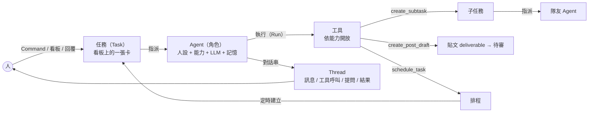
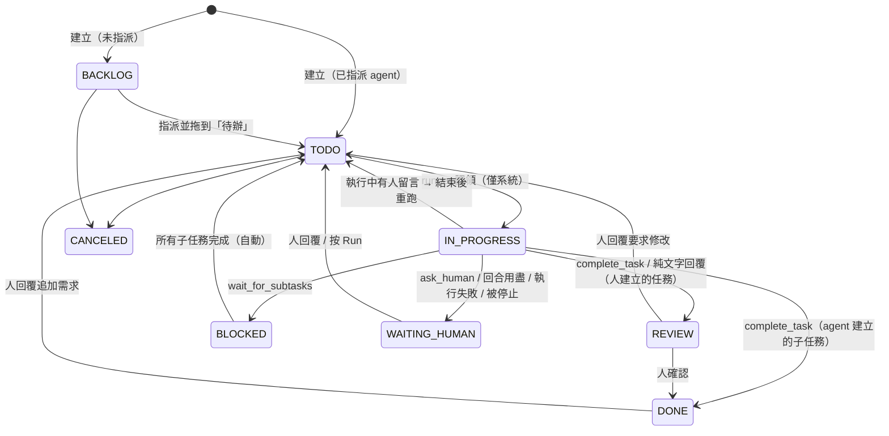
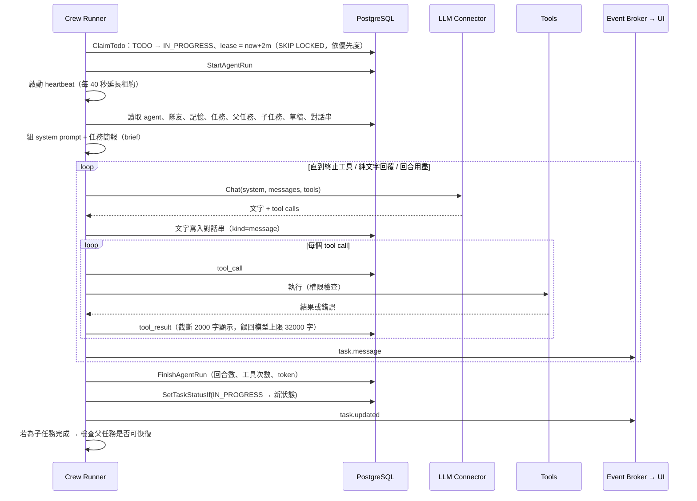
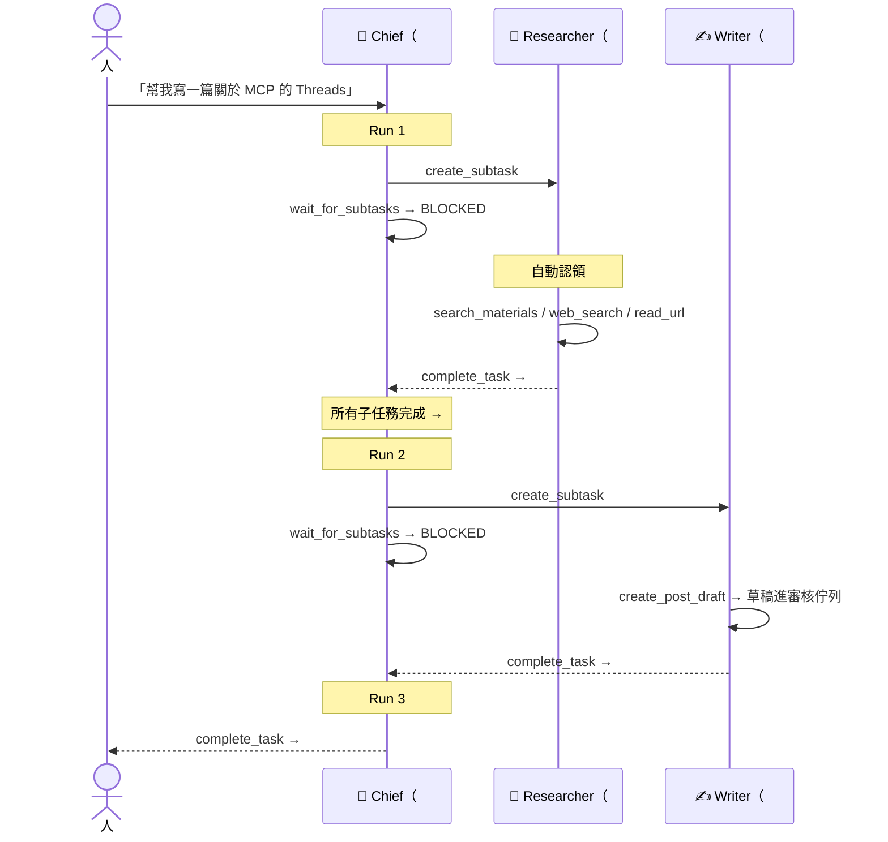
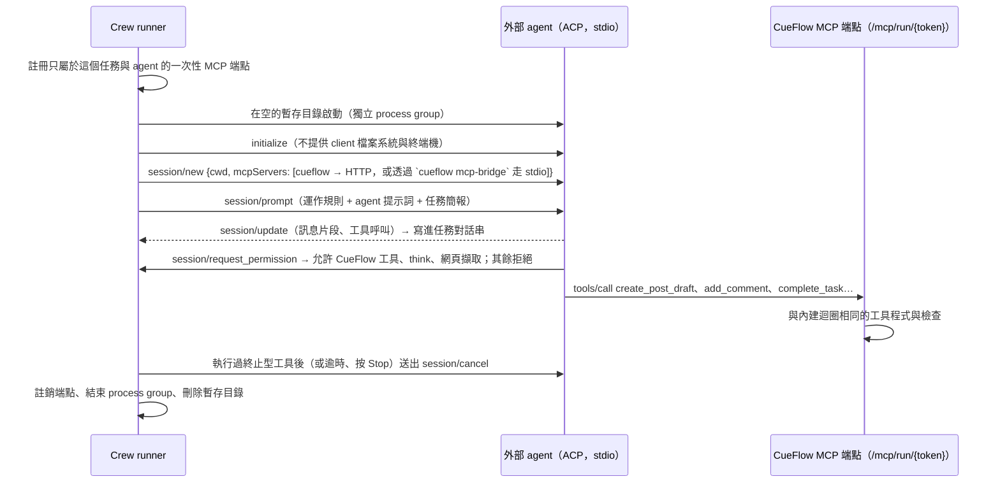

# Agentic Flow 設計

> English: [docs/agentic-flow.md](../agentic-flow.md)

> 這份文件說明 CueFlow 的 agent 團隊怎麼理解需求、分工、執行、和人協作。
> 整體系統架構見 [architecture.md](architecture.md)；相關 API 見 [api.md](../api.md) 的 Agents / Tasks / Schedules 段落。

## 1. 目標與定位

使用者用一句話交代事情（像跟 Grok bot 對話），由一組各有專長的 agent 自動完成：理解需求、拆解工作、分派給隊友、蒐集資料、寫草稿、設定定時工作，最後回報成果。整個過程攤在看板上，人可以隨時介入。

設計上有三條底線：

1. **Agent 不能發文。** 草稿一律進審核佇列，只有人能核准。這是 PRD 的 Human-in-the-loop 原則，也是安全模型的基礎。
2. **一切可見、可接手。** Agent 的每個想法、工具呼叫、結果都寫進任務對話串；人可以回覆、改指派、拖卡片、停止。
3. **有界。** 回合數、子任務、草稿數、委派深度、排程頻率都有上限，避免失控的迴圈與費用。

## 2. 核心概念

| 概念 | 說明 |
|---|---|
| **Agent（角色）** | 名稱、slug（用於 `@mention` 與委派）、頭像、角色類型、描述（給隊友看的自我介紹）、instructions（人設與長期指示）、能力、LLM／搜尋／來源 connector、語言、平台、回合上限 |
| **能力（Capability）** | 工具的權限群組。Agent 只看得到自己能力範圍內的工具 |
| **任務（Task）** | 看板上的卡片：標題、描述、狀態、優先度、標籤、指派對象、父任務、結果 |
| **對話串（Thread）** | 任務底下的訊息流，包含人和 agent 的發言、工具呼叫與結果、系統狀態、提問、最終結果 |
| **執行（Run）** | Agent 處理任務的一次工作階段；一個任務可以有多次執行（例如等待子任務後被喚醒） |
| **記憶（Memory）** | Agent 跨任務保存的筆記（偏好、事實、決定），每次執行時帶入最近 30 筆 |
| **排程（Schedule）** | cron 定時為某個 agent 建立任務 |

## 3. 預設團隊

第一次啟動且尚無任何 agent 時，系統只會自動建立一個角色：Chief（`internal/crew/defaults.go`），可以在 UI 修改；其餘的隊友由你自己新增：手動建，或匯入一份**範本團隊**：一個 JSON 檔，用法和 Grafana 的 dashboard 一樣（Agents 頁的 *Import team*；*Export team* 可以把現有 org 匯出成一份）。Repo 附了 [`templates/social-content.json`](../../templates/social-content.json)，就是下表的研究員、文案與編輯；另外還有 [`templates/developer-team.json`](../../templates/developer-team.json)，一支軟體開發團隊（產品經理、tech lead、架構師、工程師、reviewer、QA、技術文件），說明在 [templates/README.md](../../templates/README.md)（英文）：

| 角色 | slug | 能力 | 職責 |
|---|---|---|---|
| 🧭 Chief（總管，自動建立） | `chief` | planning, delegation, memory, research, sources, post_deliverables, deliverables | 對外窗口：理解需求、拆解、委派給你新增的 agent（沒有合適的就自己做）、設定排程、彙整回報；回合上限 16 |
| 🔎 Researcher（研究員，範例範本） | `researcher` | research, sources, memory | 蒐集與查證資訊，產出附來源的重點摘要 |
| ✍️ Writer（文案，範例範本） | `writer` | post_deliverables, imaging, research, sources, memory | 依平台風格寫草稿 |
| 🧐 Editor（編輯，範例範本） | `editor` | post_deliverables, memory | 檢查待審草稿的事實、語氣與規範並修稿（不能核准） |

預設角色的名稱與 instructions 都是英文；agent 回覆與撰寫草稿使用的語言由各角色的 `language` 設定決定（預設英文 `en`）；想讓 agent 用繁體中文工作，把該角色的 Language 改成 `zh-TW` 即可。

## 4. 能力與工具

| 能力 | 工具 | 說明 |
|---|---|---|
| （全體） | `add_comment` | 在對話串發進度 |
| | `ask_human` | 提問並暫停，等人回覆（終止本次執行） |
| | `complete_task` | 回報成果並結束（終止本次執行） |
| | `write_file` | 把文字存成這個任務的檔案（新建或取代）；檔案在被讀取前不會進入對話 |
| | `read_file` | 讀這個任務或其上層任務的檔案，從某個字元位置起最多 30,000 字；會告知檔案總長度，讓 agent 分段讀 |
| | `list_files` | 列出這個任務能讀的檔案：自己的與上層任務的（最多 100 個，其餘只顯示數量） |
| research | `web_search` | 透過 SearXNG / Tavily 搜尋 |
| | `read_url` | 讀公開網頁（擋內網，見 §10） |
| sources | `search_materials` | 搜尋 RSS / 信件已收集的素材（agent 勾選的來源，沒勾就是全部） |
| | `fetch_sources` | 立刻從來源 connector 抓最新內容 |
| post_deliverables（UI 上叫 Drafting） | `create_post_draft` | 為單一平台建立一件 `post` deliverable（可帶 Threads 的 `topic`、`link` 連結卡、預定發布時間 `publish_at`，以及 `media_urls`，例如工具 render 出來的影片），直接進 `PENDING_REVIEW` |
| | `list_posts` | 列出貼文 deliverable 與審核狀態 |
| | `revise_draft` | 修改仍在 `DRAFT` / `PENDING_REVIEW` 的草稿（稽核紀錄記為 agent） |
| imaging | `generate_image` | 用第一個啟用中的圖片生成 connector 生圖，並附到還能編輯的草稿上（預設用草稿的 `image_prompt`）。生圖要花錢，每次執行最多 2 張 |
| deliverables | `create_deliverable` | 送出任一已註冊 kind 的 deliverable（預設 `document`）給人審核，直接進 `PENDING_REVIEW` |
| | `list_deliverables` | 列出這個 org 的 deliverable 與狀態 |
| | `revise_deliverable` | 修改仍在 `DRAFT` / `PENDING_REVIEW` 的項目（稽核紀錄記為 agent） |
| delegation | `create_subtask` | 建立子任務並指派給隊友（立即開始） |
| | `list_agents` | 列出可委派的隊友 |
| | `wait_for_subtasks` | 暫停，等所有子任務完成後被喚醒（終止本次執行） |
| planning | `list_tasks` / `get_task` | 查看看板任務 |
| | `create_task` | 建立獨立任務（非子任務） |
| | `schedule_task` / `list_schedules` / `pause_schedule` | 管理定時任務 |
| memory | `remember` / `search_memory` | 寫入／搜尋長期記憶 |

**工具權限是三層防護：**

1. **宣告層**：送給 LLM 的工具清單只包含該 agent 能力內的工具。
2. **執行層**：模型若呼叫清單外的工具（例如被誘導呼叫發布器的 `create_post`），runner 會直接回傳錯誤結果「Tool is not available to you」，並記錄在對話串。
3. **發布層**：即使未來有人誤把發布器接進 agent，agent 執行時的 context 帶有 `guard.WithAgent` 標記，`guardedPublisher` 一律拒絕。

## 5. 任務狀態機

| 狀態 | 看板欄位 | 意義 |
|---|---|---|
| `BACKLOG` | Backlog | 想法，尚未開始 |
| `TODO` | 待辦 | 準備好了；有指派 agent 的話會被自動認領 |
| `IN_PROGRESS` | 進行中 | Agent 正在執行（只能由系統設定，人不能拖進來） |
| `BLOCKED` | 等待中 | 等子任務完成 |
| `WAITING_HUMAN` | 等待中（needs you） | Agent 提問、執行失敗、或回合用盡 |
| `REVIEW` | 待確認 | Agent 完成，等人檢查成果 |
| `DONE` / `CANCELED` | 完成 / 隱藏 | 結束 |

和 deliverable 狀態機不同，任務狀態對人是寬鬆的：看板上可以自由拖動（除了「進行中」）。嚴格的部分是 agent 結束時：只有在任務**仍是 `IN_PROGRESS`** 時才會套用新狀態（`SetTaskStatusIf`）；如果人在 agent 執行中把卡片拖走，agent 的結果會寫進對話串，但不會把卡片拉回去。

## 6. 一次執行（Run）的生命週期

### 6.1 無狀態執行

每次執行都**從頭重建上下文**，不重播上一次執行的原始 LLM 訊息：

- **System prompt**：通用工作守則 + 角色描述 + 委派守則與隊友名單（有 delegation 能力時）+ 排程守則（有 planning 時）+ 該角色的 instructions + 最近 30 筆記憶 + 目前時間。
- **任務簡報（第一則 user 訊息）**：任務標題、優先度、標籤、期限、描述、父任務、所有子任務與其結果、上一個 run 交接時留下的交接筆記（§6.3）、任務的檔案（檔名與第一行，不含內容）、已產生的草稿，以及對話串最近 60 則（工具結果壓縮到 500 字）。

好處：
- 跨 provider 無痛：不需要保存各家 LLM 的原生訊息格式；同一個任務中途換 LLM 或換 agent 都能接著做。
- 人在對話串的回覆、隊友的子任務結果、系統訊息，自然成為下一次執行的上下文。
- 單次執行內仍保留原生格式（例如 Anthropic 的 thinking block 會原樣回傳），工具迴圈不會失真。

### 6.2 結束條件與狀態對應

| 結束原因 | 寫入對話串 | 新狀態 | 執行紀錄 |
|---|---|---|---|
| `complete_task` | `result` | 人建立的任務 → `REVIEW`；agent 建立的子任務 → `DONE` | SUCCEEDED |
| 純文字回覆（沒有呼叫工具） | `result` | 同上（視為完成，適合問答類任務） | SUCCEEDED |
| `ask_human` | `question` | `WAITING_HUMAN` | SUCCEEDED |
| `wait_for_subtasks` | 系統訊息 | `BLOCKED`（若子任務其實都已完成則立即回到 `TODO`） | SUCCEEDED |
| 回合用盡 | 系統訊息（說明可回覆繼續或調高上限） | `WAITING_HUMAN` | FAILED |
| context 達到交接點（§6.3） | 交接筆記（有標示）與系統訊息 | `WAITING_HUMAN` | SUCCEEDED |
| 超過 context 上限 | 系統訊息（說明該縮減什麼，或回覆後以新的 run 繼續） | `WAITING_HUMAN` | FAILED |
| LLM／設定錯誤 | 系統訊息（含錯誤原因） | `WAITING_HUMAN` | FAILED |
| 被人停止 | 「Stopped.」 | `WAITING_HUMAN` | CANCELED |
| 程序重啟、租約過期 | 系統訊息（說明中斷） | `WAITING_HUMAN` | FAILED |

**執行中有人留言**：runner 不會打斷正在跑的 LLM 呼叫，而是在結束時檢查「本次執行開始後是否有人類訊息」。如果有，就不套用完成狀態，改回 `TODO` 立即重跑，讓新的留言被處理（被停止或失敗時除外；第一輪就超過 context 上限時也不重跑，因為重跑只會重複同樣的結果）。

### 6.3 context 快滿時交接

run 的對話歷史只往後加（已送給模型的內容不會被截斷），所以長時間的 run 會一直長大，直到接近模型的上限。最新一次的 prompt 達到交接點（預設為已知上限的 80%，`CUEFLOW_CONTEXT_HANDOFF`）時：

1. crew 在對話最後加一則訊息，請 agent 用 `write_file` 寫一份交接筆記存成 `handoff.md`（做了什麼、確認過的事實與決定、還剩什麼、先讀哪些任務檔案），然後停下。先前的回合照原樣送出。
2. 筆記存好後 run 就結束：對話串會貼一則指向筆記的訊息（標示為 *hand-off*，點擊可開啟檔案），任務等待人處理。只有在請求之後寫的筆記才算數。如果 agent 改用文字回覆，那段文字就是筆記；如果它繼續呼叫工具，會再給一輪，之後 run 結束並說明沒有寫筆記。就算交接點剛好落在 run 允許的最後一輪，也會提出請求：寫筆記的回合可以超過回合上限。
3. 人審閱後回覆，可以附上修正，也可以只說繼續。新的 run 的 brief 一開始就有「Hand-off from the previous run」區段，引用這份筆記（完整內容在 `handoff.md`），後面照常接對話串。舊的對話完全不會重播。筆記只會出現在交接後的下一個 run，不會出現在之後每一次的 brief 裡。

**不等人審核。** 開啟 **Auto hand-off** 的 agent（`auto_handoff`，預設關閉，只適用內建 runtime）在筆記存好時會跳過第 3 步：任務直接回到 `TODO`，新的 run 從筆記開始；筆記一樣會貼到對話串，也會在新 run 的 brief 裡引用。連續最多 3 次交接會這樣自動繼續，第 4 次會停下來等人，並說明原因。計數依任務的 run 紀錄計算，只算最近連續自動繼續的交接：有一次交接停下來等人（之後讓任務繼續的一定是人，不論是回覆、拖曳卡片還是 Run now）、有 run 以其他方式結束，或有人留言，計數就重新開始。沒有寫筆記的交接（agent 不理會請求）一律等人處理。使用外部 runtime 的 agent 不能開啟這個設定。

run 要比它的第一個 prompt 多長出模型上限的十分之一，才會交接。如果太早就達到交接點（brief 或筆記很大、模型上限很小），新的 run 一開始也幾乎一樣滿，只會再交接一次，所以這個 run 只會說明一次，然後照常繼續。不知道模型上限時不會交接；真的用完時，run 會以超過 context 上限的訊息結束。

## 7. 委派與恢復

規則：

- 子任務一建立就是 `TODO` 並已指派，runner 會立即認領，同時最多 3 個任務並行（`CUEFLOW_AGENT_CONCURRENCY`）。
- 父任務呼叫 `wait_for_subtasks` 後進入 `BLOCKED`。之後只要任一子任務進入 `DONE` / `REVIEW` / `CANCELED`（不論是 agent 完成還是人在看板上拖的），系統就會檢查是否所有子任務都已結束；是的話，把子任務結果摘要寫進父任務對話串，並將父任務移回 `TODO`。
- 子任務若卡在 `WAITING_HUMAN`（例如 Researcher 有問題要問），父任務會一直保持 `BLOCKED`，直到人處理完。
- 委派最多 3 層（根任務 → 子任務 → 孫任務），孫任務不能再往下委派。

## 8. 人機協作

| 人的動作 | 系統行為 |
|---|---|
| 在 Command 送出需求 | 建立指派給所選 agent（預設 Chief）的 `TODO` 任務，開啟任務頁 |
| 在看板新增卡片並指派 | 指派了 agent 就從 `TODO` 開始，否則進 `BACKLOG` |
| 把卡片拖到「待辦」 | 有指派 agent 就自動開始 |
| 在對話串留言 | 任務有 agent 且不在 `BACKLOG` / `CANCELED` → 移到 `TODO`，agent 讀到留言後繼續；若正在執行中，結束後自動重跑 |
| 留言以 `@slug` 開頭 | 先把任務轉給該 agent（正在執行的會被停止），再照上一列處理 |
| 按「Stop」或把執行中的卡片拖走 | 取消該次執行的 context，LLM 呼叫中止，任務停在 `WAITING_HUMAN` 或你拖到的欄位 |
| 改派給別的 agent | 正在執行的會被停止 |
| 審核草稿 | Agent 產生的草稿與一般草稿一樣，在 Deliverables 頁核准後才會交給發布器 |

## 9. 排程

- 人在 Schedules 頁建立，或由具備 planning 能力的 agent 透過 `schedule_task` 建立（標記 `created_by: agent`，UI 會顯示「由 agent 建立」）。
- 每次觸發建立一個新任務：標題加上日期、帶 `scheduled` 標籤、指派給設定的 agent，並立即喚醒 runner。
- 驗證：合法的 5 欄位 cron 或 `@daily` 等描述子；連續觸發間隔必須 ≥ 5 分鐘（用接下來 5 次觸發時間檢查），避免 agent 建出每分鐘跑一次的排程。驗證失敗時，錯誤會回給 agent，讓它自行修正。
- `Run now` 可以立即產生一次任務。

### 發布預設值

排程（或任務）可以指定發布器和帳號（`publisher_connector_id`、`publish_accounts`）。排程開出的任務會帶上，
子任務從上層繼承，agent 為這類任務寫的草稿會自動選好這個發布器，以及和草稿平台相符的帳號。有勾帳號時，任務說明會告訴 agent
這些帳號涵蓋哪些平台，`create_post_draft` 也會拒絕其他平台的草稿（例如只勾 Threads 帳號就不能寫 Instagram 草稿）。草稿仍然要經過人工審核，
預設值只是省去每次手動選擇。

## 10. 防護與上限

| 項目 | 上限／行為 | 位置 |
|---|---|---|
| 每次執行回合數 | 角色設定 `max_turns`（預設 12，Chief 16，最高 40） | `store/agents.go` |
| run 的 context 可以多滿 | 預設為模型上限的 80%（`CUEFLOW_CONTEXT_HANDOFF`）；超過時 run 會寫交接筆記並等人處理（§6.3），寫筆記最多可以超過回合上限 2 輪。任務頁會把每個 run 最新一次的 prompt 顯示成「Context 182K / 1M (18%)」，達到這個比例起變色，不知道模型上限時則不顯示百分比 | `config`、`crew/handoff.go` |
| 下一次 brief 帶入的交接筆記 | 12,000 字（其餘在 `handoff.md`） | `crew/handoff.go` |
| 連續自動交接次數（開啟 Auto hand-off 時） | 3 次；下一次會等人處理。有交接停下等人、有 run 以其他方式結束，或有人留言，計數就重新開始 | `crew/handoff.go` |
| 每次執行建立的子任務 + 獨立任務 | 8 | `crew/tools.go` |
| 每次執行建立的草稿 | 10 | `crew/tools.go` |
| 委派深度 | 3 層 | `crew/tools.go` |
| 餵回模型的單一工具結果 | 回傳外部內容的工具（MCP 工具，含經人核准的呼叫；`read_url`；`search_materials`），其超過 8,000 字（`saveResultOver`）的文字結果會完整存成任務檔案 `results/<工具>-<n>.txt`（第一行是工具與參數；不會覆蓋既有檔案），模型收到檔名、總長度和前 2,000 字，以及接著讀的位置。回報 CueFlow 自身狀態的工具（任務、agent、記憶、子任務結果、檔案）照舊直接放進對話；錯誤、非文字結果、超過 8 MB 的結果，以及存檔失敗的結果也一樣。直接放進對話的結果超過 32,000 字會截斷並附註截掉多少（顯示在對話串時為 2,000 字） | `crew/files.go`、`crew/tools.go` |
| 一次 run 的對話歷史 | 所有 connector 都只往後加：已送給模型的內容不會被截斷或改寫（Claude 的 thinking block 綁定這些內容），除了模型本身的 context 上限外沒有其他限制。Claude connector 會快取它（Prompt caching，預設開啟；端點不接受 `cache_control` 時，connector 會不帶它重試並記一筆警告）；其他 connector 每輪都重送完整歷史，除非 provider 自己有快取。run 超過 context 上限時會停下並說明原因；回覆後會從任務和對話串重新開始一個新的 run | `crew/crew.go`、`connectors/anthropic` |
| 任務簡報帶入的對話 | 最近 60 則 | `crew/prompt.go` |
| 任務簡報列出的檔案 | 最多 30 個（名稱、大小、屬於哪個任務、第一行開頭；不含內容），其餘只顯示數量；`list_files` 最多列出 100 個 | `crew/files.go` |
| 單次 `read_file` | 30,000 字 | `crew/files.go` |
| 單一任務檔案 | 8 MB | `store/task_files.go` |
| 帶入的記憶 | 最近 30 筆，單筆 2,000 字 | `crew/crew.go`、`store/agents.go` |
| 排程頻率 | ≥ 5 分鐘 | `scheduler.ValidateSchedule` |
| 並行任務 | 3（`CUEFLOW_AGENT_CONCURRENCY`） | `config` |
| 單次模型呼叫 | 10 分鐘；所有 LLM connector 都以串流接收回覆，長回覆不會被其他 connector 請求適用的 90 秒逾時切斷，也不會被 proxy 的閒置逾時切斷。Claude connector 最多等 2 分鐘開始回應，串流中斷或回報過載時會重試；不支援串流的 OpenAI 相容伺服器照舊一次讀取，同樣以 10 分鐘為限 | `llm/llm.go`、`connectors/anthropic`、`connectors/openai` |
| 執行租約 | 2 分鐘，每 40 秒續約；過期 → `WAITING_HUMAN` | `crew/crew.go` |
| `read_url` | 只允許 http(s)；連線時擋 loopback / 私有 / link-local / CGNAT / multicast；最多 5 次重新導向；2 MB、8,000 字、30 秒；不走系統 proxy（`CUEFLOW_AGENT_ALLOW_PRIVATE_URLS=true` 可放寬） | `crew/fetch.go` |
| 發布 | 任何 agent 都做不到，見 §4 | `guard`、`connector` |

## 11. 提示詞設計

System prompt 由程式組合，順序固定：

1. **身分與工作守則**：你是誰、正在處理任務 #N、自主推進、必要時才問人、不能發文、事實必須有來源、長任務要回報進度、結束時用 `complete_task` 總結、用指定語言溝通。
2. **委派守則與隊友名單**（有 delegation 能力時）：每位隊友的 slug、角色、描述與能力，引導「交給專家，但不要為瑣事開子任務」，完成前要檢查子任務成果。
3. **排程守則**（有 planning 能力時）：週期性需求用排程而不是只做一次，並推斷合適的時區。
4. **角色 instructions**：使用者在 UI 編輯的人設與長期指示。
5. **記憶**、**目前時間**。

角色之間的差異全部來自「能力（決定看得到哪些工具）」加上「instructions（決定怎麼做）」，因此新增一個角色（例如「數據分析師」或「客服回覆員」）不需要改程式。

## 11a. 外部 agent（ACP runtime）

agent 可以把執行工作交給外部的 coding agent，取代 CueFlow 內建的 LLM 迴圈。agent 的 **Runtime** 指向一個「External agent (ACP)」connector（型別 `acp_agent`、類型 `runtime`），裡面描述怎麼啟動它：預設有 Claude Code（`claude-agent-acp`）、Codex（`codex-acp`）、Gemini CLI（`gemini --acp`）、OpenCode（`opencode acp`）、Goose（`goose acp`），也可以自訂指令。憑證（API key、`claude setup-token` 產生的 Claude Code OAuth token）加密存在 connector，以環境變數傳給 agent。

- **同樣的工具、同樣的保證**：MCP 端點只提供該 agent 能力範圍內的工具，由和內建迴圈相同的程式執行（寫入對話串、各種上限、草稿進審核），依然沒有任何發布工具。
- **權限政策**：允許 CueFlow 的 MCP 工具、`think`，以及（可設定）`fetch`；`execute`、`edit`、`read`、`delete`、`move`、`search` 與其他類型一律拒絕，並記在對話串。client 也不宣告檔案系統與終端機能力。
- **無狀態執行**：每次執行都是全新的 ACP session，用任務簡報重建上下文，和內建迴圈相同，不需要管理 session ID。
- **結果對應**：有呼叫終止型工具就以它為準；否則 `end_turn` → 完成（以 agent 最後一則訊息為結果），`max_turn_requests`／`max_tokens` → 回合用盡，`refusal` → 失敗，逾時 → 失敗。
- **Token 用量**：agent 在 prompt 結果中回報時才會記錄。

## 11b. 外部工具（MCP server）

操作者可以新增 **MCP server** connector（類型 `tools`，支援 Streamable HTTP、SSE、stdio），並指定給 agent 使用
（`tool_connector_ids`）。它的工具會以 `<server>__<tool>` 的名稱出現在這些 agent 的工具清單裡，內建 loop 與 ACP runtime 都適用。

每個工具在 connector 頁面設定權限：

| 權限 | 效果 |
|---|---|
| `allow` | agent 直接呼叫 |
| `ask` | 呼叫會先記錄（`tool_approvals`），在任務對話顯示核准卡片，本次執行結束、任務停在 `WAITING_HUMAN`。按 **Approve & run** 由伺服器端執行並把結果寫回對話；按 **Reject** 寫回拒絕（可附說明）。沒有待核准的呼叫後，任務回到 `TODO`，agent 帶著結果繼續 |
| `deny` | agent 看不到這個工具 |

沒有設定過的工具用預設值：server 標示唯讀（或名稱像查詢：get、list、search…）就是 `allow`，其他是 `ask`。
看起來會發文、傳訊息、刪資料或動到金流的工具會標成 *risky*，要改成允許時會再確認一次。server 之後新增的工具也套用預設值，
所以除非是唯讀，新工具不會在沒人看的情況下執行。權限由操作者自行決定：允許的工具會在 CueFlow 審核流程之外執行。

## 12. 端到端範例

使用者在 Command 輸入：「每天早上 8 點整理 AI 新聞並寫成 Threads 草稿」。

1. 建立任務 #1，指派 Chief，狀態 `TODO`。
2. **Chief Run 1**：判斷這是週期性需求，但時間點不明確時會 `ask_human`；這裡已經說了 8 點，所以直接 `schedule_task`（`0 8 * * *`、`Asia/Taipei`，指派 Writer，描述寫清楚要蒐集前一天的 AI 新聞並寫草稿），再用 `remember` 記住「使用者偏好每天 8 點收 AI 新聞草稿」，最後 `complete_task` 回報設定了什麼。#1 → `REVIEW`。
3. 隔天 08:00：排程建立任務 #2「整理 AI 新聞寫成 Threads 草稿 · 2026-10-05」，指派 Writer，自動開始。
4. **Writer Run**：`fetch_sources` → `search_materials` → 需要時 `web_search` / `read_url` 查證 → `create_post_draft`（Threads，超過 500 字會自動拆成串文）→ `complete_task` 回報草稿 ID。#2 → `REVIEW`。
5. 你在 Deliverables 頁看到草稿，修改後核准 → deliverables worker 交給發布器發出。
6. 想調整風格時，直接在 #2 留言「語氣再犀利一點，結尾加問題」，Writer 會重跑並用 `revise_draft` 修改尚未核准的草稿；或者用 `@editor 幫我檢查` 把任務轉給 Editor。

## 13. 已知限制與後續方向

- **成本控管**：目前以回合與數量上限控管，尚未有以 token 或金額計算的預算上限；`agent_runs` 已記錄 token 用量，可作為後續做每日預算的基礎。
- **長任務壓縮**：上下文採「最近 60 則」截斷，非常長的任務可能遺失早期細節；可以改成由 agent 自己寫階段摘要。
- **結構化產出**：子任務結果目前是自由文字；要做資料管線時可加上 JSON schema 輸出。
- **外部 MCP 工具**：`internal/mcpx` 已提供工具分類（擋掉具副作用的工具），之後可以讓 agent 使用唯讀的第三方 MCP 工具。
- **單實例**：cron 不適合多實例部署（見 architecture.md §8）。
