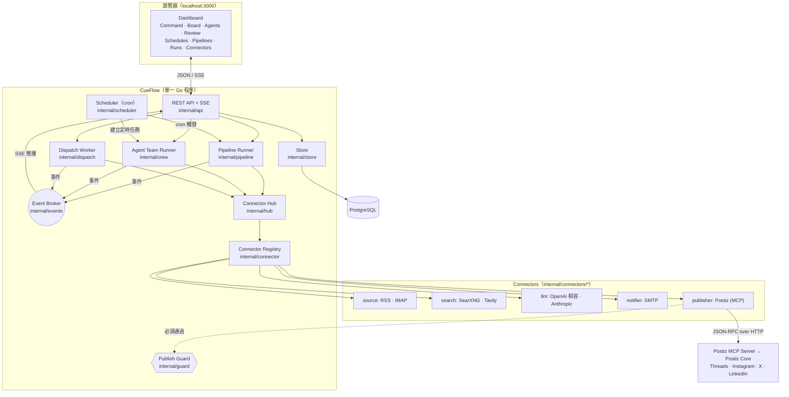
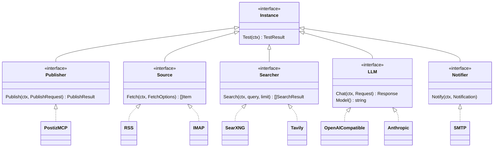
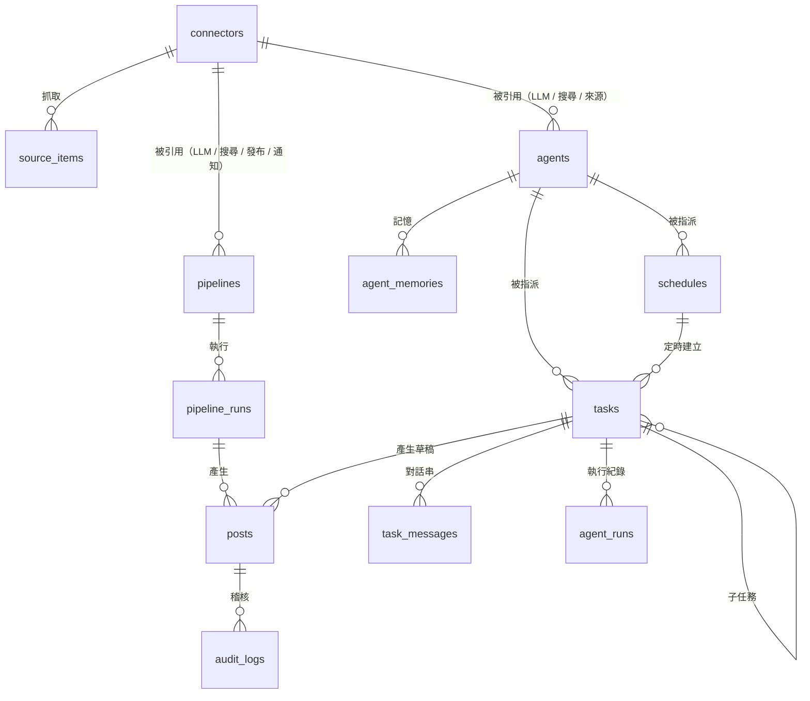
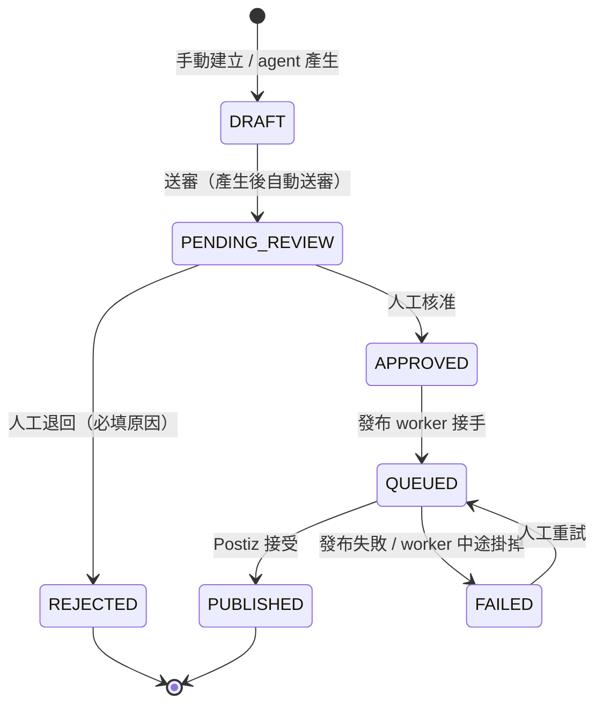
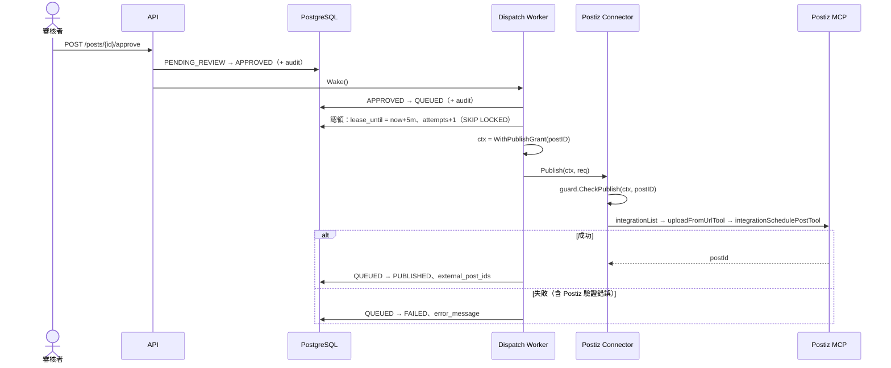
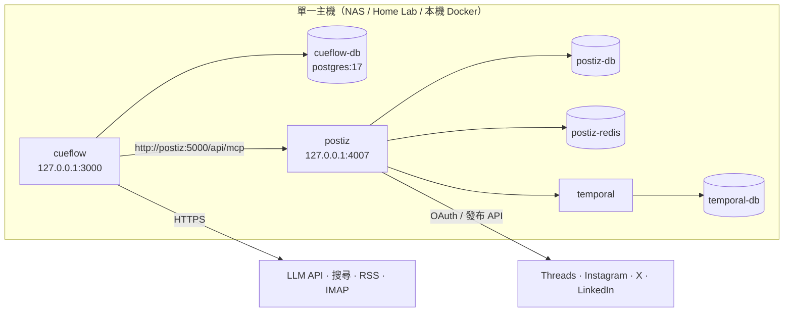

# CueFlow 整體架構設計

> English: [docs/architecture.md](../architecture.md)

> 對象：要部署、維運或擴充 CueFlow 的開發者。Agent 團隊的運作細節見 [agentic-flow.md](agentic-flow.md)，
> REST 介面見 [api.md](../api.md)，插件開發見 [connectors.md](../connectors.md)。

## 1. 設計目標與原則

| 原則 | 在架構上的落實 |
|---|---|
| **Human-in-the-loop First** | 所有貼文走嚴格狀態機；只有人能把貼文推到 `APPROVED`；發布器被包一層授權檢查，只有發布 worker 能對「已核准的那一篇」呼叫 |
| **Zero-Public-Exposure** | 全部採主動輪詢（RSS / IMAP / MCP 呼叫），不需要 Webhook；預設只綁 `127.0.0.1:3000` |
| **Protocol-Driven** | 核心不依賴任何社群平台 SDK；發布透過 MCP 呼叫 Postiz，且 Postiz 本身只是一個 connector 插件 |
| **一切皆插件** | 發布器、資料來源、搜尋、LLM、通知都是 connector，用同一套註冊／設定／加密機制 |
| **單一程序、易部署** | Go 單一 binary（API + 排程 + 發布 worker + agent runner），前端靜態檔 embed 在內；唯一外部依賴是 PostgreSQL |
| **可觀測、可稽核** | 貼文每次狀態變動與人工修改都寫入 `audit_logs`；agent 的每一步寫入任務對話串與 `agent_runs` |

## 2. 系統全貌

### 2.1 套件職責

| 套件 | 職責 |
|---|---|
| `cmd/cueflow` | 進入點：載入設定、連線 DB、跑 migration、組裝所有元件、優雅關機；子命令 `migrate` / `genkey` / `healthcheck` |
| `internal/config` | 從環境變數載入設定（`CUEFLOW_*`、`DATABASE_URL`） |
| `internal/db` | 連線池、內嵌 SQL migration（advisory lock 防止多實例同時 migrate） |
| `internal/domain` | 貼文狀態機、平台規則（字數、hashtag、是否支援串文、是否需要圖片） |
| `internal/store` | 所有 PostgreSQL 存取；交易內同時寫狀態與稽核紀錄 |
| `internal/secret` | AES-256-GCM 加解密 connector 機密欄位 |
| `internal/connector` | 插件註冊表、設定 schema、五種 kind 介面、發布器授權包裝 |
| `internal/connectors/*` | 內建插件實作 |
| `internal/hub` | 從 DB 讀出 connector、解密、呼叫工廠建立實例 |
| `internal/mcpx` | MCP client 封裝（Streamable HTTP / SSE / stdio）、工具分類 |
| `internal/guard` | 發布授權（context 上的 grant 與 agent 標記） |
| `internal/agent` | Pipeline 用的草稿產生器（固定兩個工具的 LLM 迴圈） |
| `internal/crew` | Agent 團隊執行器：認領任務、工具迴圈、委派、排程、記憶 |
| `internal/pipeline` | 排程內容管線：收集 → 產生 → 存成待審 → 通知 |
| `internal/dispatch` | 發布 worker：`APPROVED → QUEUED → PUBLISHED / FAILED` |
| `internal/scheduler` | cron：觸發 pipeline、產生定時任務、寄送待審摘要 |
| `internal/events` | 程序內 pub/sub，供 SSE 即時推播 |
| `internal/api` | REST + SSE、管理 token 驗證、提供內嵌前端 |
| `internal/webui` | 內嵌 Next.js 靜態輸出（`web/out` → `internal/webui/dist`） |
| `web/` | Next.js + Tailwind 前端（static export） |

### 2.2 背景迴圈

一個 CueFlow 程序內同時跑四種背景工作，彼此只透過資料庫狀態溝通：

| 迴圈 | 頻率 | 做什麼 |
|---|---|---|
| Scheduler | cron 表達式 | 觸發 pipeline run；依排程建立任務；（選用）寄待審摘要 |
| Pipeline Runner | 被觸發時 | 一次完整的「收集 → 產生 → 待審」流程，單次上限 30 分鐘 |
| Dispatch Worker | 每 3 秒，或核准後立即喚醒 | 把已核准貼文送去發布 |
| Crew（Agent Runner） | 每 2 秒，或有新任務時立即喚醒 | 認領 `TODO` 任務並讓 agent 執行，預設同時 3 個 |

「喚醒」是非阻塞的 channel 通知，所以按下核准或指派任務後幾乎立刻開始處理；定時輪詢只是保險。

## 3. Connector 插件模型

一個插件 = 一個 package，在 `init()` 裡呼叫 `connector.Register(spec, factory)`：

- **Spec**：型別名稱、kind、欄位清單（型別、必填、預設值、是否機密）。前端依 Spec 自動產生設定表單，`/api/v1/meta` 會回傳所有 Spec。
- **Factory**：拿到「已驗證、已套預設值、已解密」的設定與 `Env`（logger、HTTP client、狀態儲存），回傳實例。
- **Build 流程**：`hub.Instance(id)` → 讀 DB → 解密 secrets → `Spec.WithDefaults` → `Spec.Validate` → factory → 檢查實例確實實作該 kind 的介面 → 若是 publisher，**包上 `guardedPublisher`**。

新增一個整合不需要改核心，只要新增 package 並在 `internal/connectors/all` 加一行 blank import。

## 4. 資料模型

| 資料表 | 重點設計 |
|---|---|
| `connectors` | 一般設定放 `config`（JSONB，可顯示）；機密欄位加密後放 `secrets`（BYTEA）；`state` 給插件存游標 |
| `source_items` | `UNIQUE(connector_id, external_id)` 實現增量抓取（RSS 用 GUID、信件用 Message-ID）；`consumed_at` 避免同一則素材被重複寫文 |
| `pipelines` / `pipeline_runs` | 排程內容管線與每次執行的統計、逐步 log |
| `posts` | 狀態、串文分段、hashtag、媒體、`version`（樂觀鎖）、`lease_until`（發布租約）、`external_post_ids`、`task_id` / `run_id`（來源追溯） |
| `audit_logs` | 每次狀態變動與修改（含前後差異）；`seq` 保證同一交易內的順序 |
| `agents` / `agent_memories` | 角色設定與長期記憶 |
| `tasks` / `task_messages` / `agent_runs` | 看板任務、對話串、每次 agent 執行的回合數與 token 用量 |
| `schedules` | 定時建立任務的 cron 設定 |

Migration 檔在 `internal/db/migrations/`，啟動時自動套用。

## 5. 貼文生命週期與發布

### 5.1 狀態機

- 轉換規則只定義在 `internal/domain/post.go` 一處，任何不在表上的轉換都會回傳 `invalid_transition`。
- 只有 `DRAFT` / `PENDING_REVIEW` 可以編輯，編輯需帶 `version`，版本不符回 `409`。
- 每次轉換與稽核紀錄在**同一個交易**內寫入。

### 5.2 發布流程

### 5.3 防止重複發布

發布前先取得租約（`lease_until`）。如果 worker 在發布途中掛掉、租約過期，下次啟動時該貼文會被標成 `FAILED`，並註明「可能已發出，重試前請先確認平台」，**不會自動重發**。因為我們無法得知 Postiz 是否已經收到，自動重試可能造成重複貼文。

### 5.4 Pipeline（排程內容管線）

Pipeline 是比 agent 團隊更簡單、更可預測的自動化：

1. cron 觸發，以 `SELECT … FOR UPDATE` 加上「同一 pipeline 只能有一個 RUNNING」防止重疊執行。
2. 對每個來源 connector 增量抓取，寫入 `source_items`（重複的自動略過）。
3. 取回看回時間內、尚未用過的素材（上限 `max_items`）。
4. `internal/agent` 的產生器只開放 `web_search` 與 `submit_drafts` 兩個工具，產出每個平台一篇草稿；超過字數的 Threads / X 內容會自動拆成串文。
5. 存成 `PENDING_REVIEW` 貼文、標記素材已使用、寄出審核提醒信。

需要「理解需求、拆解、委派、追問」的工作交給 agent 團隊；固定格式、每天產稿的工作用 pipeline 比較省、也比較穩定。

## 6. 安全模型

| 威脅 | 防護 |
|---|---|
| LLM 幻覺或被 prompt injection 誘導直接發文 | Agent 能用的工具裡沒有任何發布工具；agent 的 context 帶有標記，`guardedPublisher` 會拒絕；發布必須帶有 dispatch worker 對**該篇貼文**授予的 grant |
| 外部素材（RSS、網頁）夾帶指令 | 同上：最壞情況只會產生一篇待審草稿；所有 agent 行為寫入對話串可追溯 |
| Agent 被誘導存取內網（SSRF） | `read_url` 在連線（dial）時檢查解析後的 IP，擋掉 loopback、私有網段、link-local（含雲端 metadata `169.254.169.254`）、CGNAT；重新導向也會重新檢查；不走系統 proxy |
| 資料庫外洩導致金鑰外洩 | Connector 機密欄位以 AES-256-GCM 加密，associated data 綁定 connector ID（把密文搬到別列也解不開）；API 永遠不回傳機密值 |
| 未授權存取控制台 | 預設只綁 localhost；可設 `CUEFLOW_ADMIN_TOKEN` 要求 Bearer token（以 constant-time 比對） |
| Agent 失控產生大量任務或費用 | 每次執行的回合數、子任務數、草稿數、委派深度都有上限；排程最密每 5 分鐘一次（詳見 agentic-flow.md） |
| Worker 當機造成重複發布 | 租約機制，見 5.3 |

## 7. 即時更新

`internal/events` 是程序內的 pub/sub。所有狀態變動（貼文、任務、對話串、執行、connector、agent、排程）都會發佈事件，`GET /api/v1/events` 以 SSE 推給瀏覽器，前端收到後重新抓取對應資料。慢的訂閱者會被丟事件而不會卡住系統，前端斷線重連時也會整頁重新抓取，所以不依賴事件必達。

## 8. 部署拓樸

- `deploy/docker-compose.yml`：`cd deploy && docker compose up -d` 一次帶起全部服務，所有 port 都只綁 `127.0.0.1`。遠端存取建議用 SSH tunnel 或 Tailscale。
- CueFlow 映像是 distroless、非 root，內建 `healthcheck` 子命令。
- 開發或試用可用 `--profile mock` 啟動模擬的 Postiz MCP server。
- 目前設計為**單實例**。任務與發布的認領都用資料庫租約與 `SKIP LOCKED`，跑兩個實例不會重複處理，但 cron 會在每個實例各觸發一次，因此不建議水平擴充。

## 9. 擴充點

| 想做的事 | 從哪裡改 |
|---|---|
| 接新的發布管道、資料來源、搜尋、LLM、通知 | 新增 connector 插件（[connectors.md](../connectors.md)） |
| 新增平台規則（字數、hashtag 上限） | `internal/domain/platform.go` |
| 給 agent 新工具 | `internal/crew/tools.go`：定義工具、歸屬能力（不要給任何能發布的工具） |
| 新增預設角色 | `internal/crew/defaults.go` |
| 改 agent 的工作守則 | `internal/crew/prompt.go`（全體）或在 UI 編輯單一角色的 instructions |
| 新增資料表 | `internal/db/migrations/000N_*.sql` |
