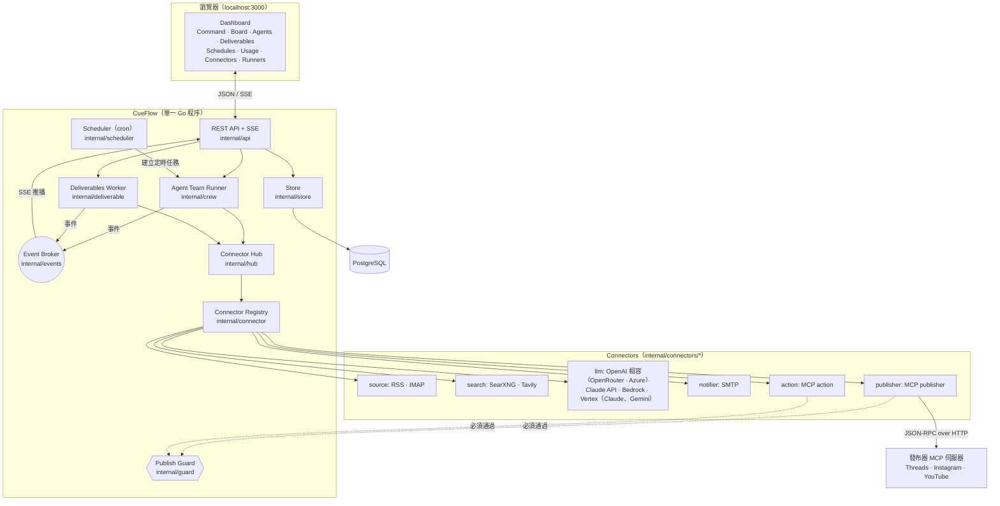
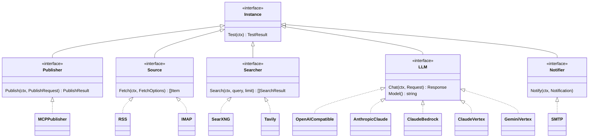
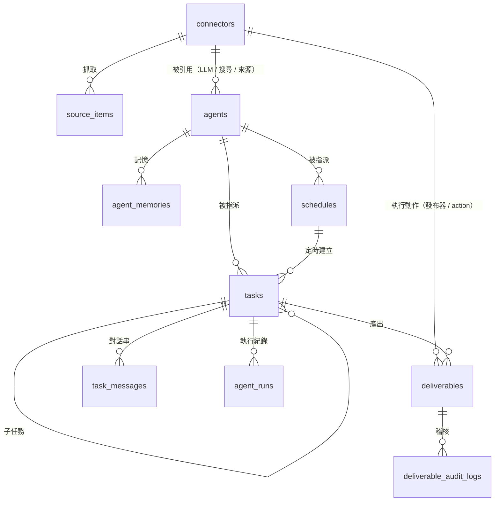
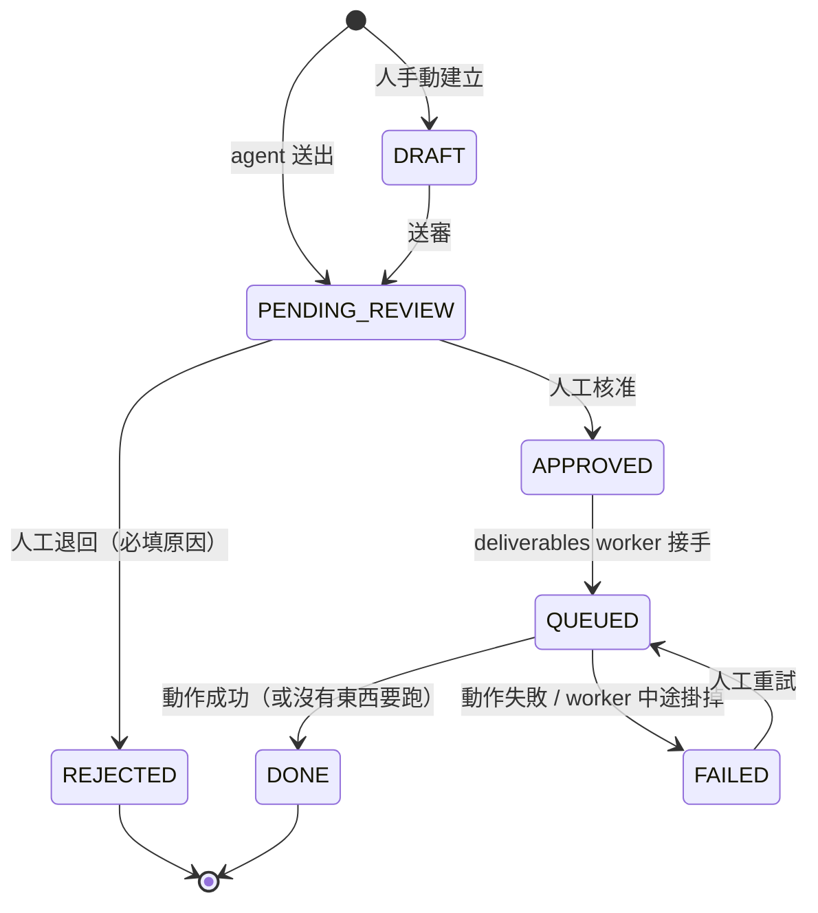
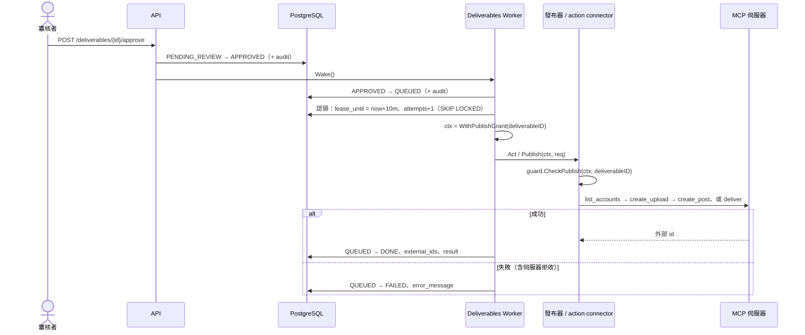
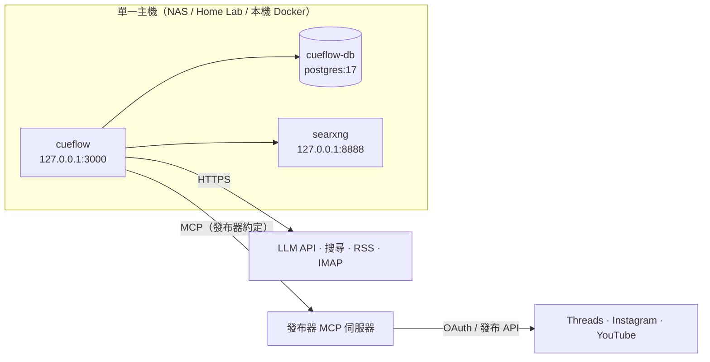

# CueFlow 整體架構設計

> English: [docs/architecture.md](../architecture.md)

> 對象：要部署、維運或擴充 CueFlow 的開發者。Agent 團隊的運作細節見 [agentic-flow.md](agentic-flow.md)，
> REST 介面見 [api.md](../api.md)，插件開發見 [connectors.md](../connectors.md)。

## 1. 設計目標與原則

| 原則 | 在架構上的落實 |
|---|---|
| **Human-in-the-loop First** | 每件 deliverable（貼文、文件……）都走嚴格狀態機；只有人能把它推到 `APPROVED`；發布器與 action connector 被包一層授權檢查，只有 deliverables worker 能對「已核准的那一件」呼叫 |
| **Zero-Public-Exposure** | 全部採主動輪詢（RSS / IMAP / MCP 呼叫），不需要 Webhook；預設只綁 `127.0.0.1:3000` |
| **Protocol-Driven** | 核心不依賴任何社群平台 SDK；發布透過 MCP 呼叫擁有平台帳號的發布器伺服器，而那個發布器本身只是一個 connector 插件 |
| **一切皆插件** | 發布器、資料來源、搜尋、LLM、通知都是 connector，用同一套註冊／設定／加密機制 |
| **單一程序、易部署** | Go 單一 binary（API + 排程 + deliverables worker + agent runner），前端靜態檔 embed 在內；唯一外部依賴是 PostgreSQL |
| **可觀測、可稽核** | deliverable 每次狀態變動與人工修改都寫入 `deliverable_audit_logs`；agent 的每一步寫入任務對話串與 `agent_runs` |

## 2. 系統全貌



### 2.1 套件職責

| 套件 | 職責 |
|---|---|
| `cmd/cueflow` | 進入點：載入設定、連線 DB、跑 migration、組裝所有元件、優雅關機；子命令 `migrate` / `genkey` / `healthcheck` / `rotate-key` / `runner` / `media` / `mcp-bridge` |
| `cmd/mock-publisher-mcp` | 不會真的發文的發布器 MCP 伺服器，給開發與示範用（`internal/publishermock`） |
| `internal/config` | 從環境變數載入設定（`CUEFLOW_*`、`DATABASE_URL`） |
| `internal/db` | 連線池、內嵌 SQL migration（advisory lock 防止多實例同時 migrate） |
| `internal/domain` | 各層共用的錯誤（`ErrNotFound`、`ErrVersionConflict`、`TransitionError`） |
| `internal/store` | 所有 PostgreSQL 存取；交易內同時寫狀態與稽核紀錄 |
| `internal/secret` | AES-256-GCM 加解密 connector 機密欄位 |
| `internal/connector` | 插件註冊表、設定 schema、五種 kind 介面、發布器授權包裝 |
| `internal/connectors/*` | 內建插件實作 |
| `internal/hub` | 從 DB 讀出 connector、解密、呼叫工廠建立實例 |
| `internal/mcpx` | MCP client 封裝（Streamable HTTP / SSE / stdio）、工具分類 |
| `internal/guard` | 發布授權（context 上的 grant 與 agent 標記） |
| `internal/llm` | 工具迴圈共用、與供應商無關的對話型別；LLM connector 負責轉成各自的格式 |
| `internal/crew` | Agent 團隊執行器：認領任務、工具迴圈、委派、排程、記憶；模組用來登記能力與工具的註冊表 |
| `internal/content` | 建在 deliverables 上的社群內容模組：`post` kind（平台規則當驗證、透過 publisher connector 發布當動作）、素材、發布器帳號與寫稿工具；透過 `api.Module` 與 crew 註冊表掛在核心上 |
| `internal/deliverable` | Deliverables 模組：任何 agent 都能產出的有型別項目（kind 負責驗證 payload）、一套附稽核紀錄的審核狀態機，以及核准後在 grant 下執行該 kind 自己的動作（貼文就是發布）或 action connector 的 worker |
| `internal/scheduler` | cron：依排程建立任務，觸發模組登記的 cron 資料列與週期工作 |
| `internal/events` | 供 SSE 即時推播的 pub/sub，透過 PostgreSQL `LISTEN/NOTIFY` 擴散 |
| `internal/jobs` | 背景工作請求（「跑這個任務」、「觸發這個排程」，加上模組登記的種類）：本機在程序內處理，雲端模式交給 Cloud Tasks（`internal/jobs/cloudtasks`） |
| `internal/acpx` / `internal/acpdrive` | 以 stdio 啟動 ACP agent；在 CueFlow 的沙箱政策下讓它執行一次 prompt；伺服器與 Runner 共用 |
| `internal/runner` / `internal/runnerapi` | `cueflow runner register\|run\|status`（Runner 的機器端）與通訊協定 |
| `internal/blob` | 把媒體位元組存到資料庫之外（`file://`、`gcs://` 加簽名網址）；每一列記錄存放在哪個後端 |
| `internal/media` | 類型與大小檢查、上傳、圖片生成、交給發布器的 `/media/{id}` 引用 |
| `internal/internalauth` / `internal/googleid` | 驗證 `/internal/*` 上 Google 簽發的 token；替 CueFlow 自己呼叫私有 Cloud Run 服務簽章 |
| `internal/cfaccess` | 辨識通過 Cloudflare Access 的請求（雲端的儀表板登入） |
| `internal/textutil` | 給發布器用的串文切分與 HTML 轉換 |
| `internal/api` | REST + SSE、管理 token 驗證、提供內嵌前端 |
| `internal/webui` | 內嵌 Next.js 靜態輸出（`web/out` → `internal/webui/dist`） |
| `web/` | Next.js + Tailwind 前端（static export） |

### 2.2 背景迴圈

一個 CueFlow 程序內同時跑三種背景工作，彼此只透過資料庫狀態溝通：

| 迴圈 | 頻率 | 做什麼 |
|---|---|---|
| Scheduler | cron 表達式 | 依排程建立任務；觸發模組登記的 cron 資料列與週期工作 |
| Deliverables Worker | 每 3 秒（`CUEFLOW_DISPATCH_INTERVAL`），或核准／重試後立即喚醒 | 對已核准的 deliverable 執行動作：發布貼文、呼叫 action connector |
| Crew（Agent Runner） | 每 2 秒，或有新任務時立即喚醒 | 認領 `TODO` 任務並讓 agent 執行，預設同時 3 個 |

「喚醒」是非阻塞的 channel 通知，所以按下核准或指派任務後幾乎立刻開始處理；定時輪詢只是保險。

### 2.3 Agent 的工作在哪裡執行

Agent 的 runtime 決定誰來執行它的任務。不論哪一種，工具伺服器、對話串與結果處理都相同，所以審核、權限與「agent 不會發布」
都不依賴 runtime。

| Runtime | 誰決定做什麼 | 誰執行 |
|---|---|---|
| 內建（沒有 runtime connector） | CueFlow 的 agent loop | CueFlow，呼叫 LLM connector |
| `acp_agent` | CueFlow | 在 CueFlow 主機上啟動的 ACP agent CLI |
| `runner_pool` | CueFlow | 已註冊 **Runner** 上的 ACP agent CLI |
| `external`（自主） | Agent 自己 | Agent 自己，用 agent token 透過 MCP |

**Runner。** `runner_pool` 的 agent 照常由 crew 認領任務、註冊 per-run MCP 工具伺服器，並寫入一筆 `runner_jobs`（標籤、
prompt、工具伺服器路徑）。Runner 對 `/api/runner/v1/jobs/claim` 做 long-poll；認領使用 `FOR UPDATE SKIP LOCKED`，並比對標籤
（`job.labels <@ runner.labels`）與 org。Runner 在本機啟動 agent，agent 直接呼叫 CueFlow 的 MCP 工具，Runner 回傳對話事件並送心跳
（2 分鐘 lease）。當終止型工具（`complete_task`、`ask_human`⋯）結束任務，伺服器把 job 改為 `canceling`；Runner 下一次心跳得知後
停止 agent、回報最後的對話並完成 job。超過 `queue_timeout_minutes` 沒人認領，或 Runner 停止心跳，任務會失敗。
Runner 與 agent token 只儲存 SHA-256。

**自主 agent。** 認領迴圈會略過 runtime 為 `external` 的 agent。它們透過 agent-token 的 MCP 端點認領任務
（`ClaimTaskForAgent`：`TODO → IN_PROGRESS`，30 分鐘 lease，每次呼叫都會延長）；沉默的任務由 crew 的 lease 回收退回 `TODO`。

## 3. Connector 插件模型



一個插件 = 一個 package，在 `init()` 裡呼叫 `connector.Register(spec, factory)`：

- **Spec**：型別名稱、kind、欄位清單（型別、必填、預設值、是否機密）。前端依 Spec 自動產生設定表單，`/api/v1/meta` 會回傳所有 Spec。
- **Factory**：拿到「已驗證、已套預設值、已解密」的設定與 `Env`（logger、HTTP client、狀態儲存），回傳實例。
- **Build 流程**：`hub.Instance(id)` → 讀 DB → 解密 secrets → `Spec.WithDefaults` → `Spec.Validate` → factory → 檢查實例確實實作該 kind 的介面 → 若是 publisher，**包上 `guardedPublisher`**。

新增一個整合不需要改核心，只要新增 package 並在 `internal/connectors/all` 加一行 blank import。

## 4. 資料模型



| 資料表 | 重點設計 |
|---|---|
| `connectors` | 一般設定放 `config`（JSONB，可顯示）；機密欄位加密後放 `secrets`（BYTEA）；`state` 給插件存游標 |
| `source_items` | `UNIQUE(connector_id, external_id)` 實現增量抓取（RSS 用 GUID、信件用 Message-ID）；`consumed_at` 避免同一則素材被重複寫文 |
| `deliverables` | `kind`、JSON `payload`、狀態、`version`（樂觀鎖）、`lease_until` / `attempts`（動作租約）、`external_ids` / `result`（動作回傳的結果）、`action_connector_id`、`task_id`（來源追溯） |
| `deliverable_audit_logs` | 每次狀態變動與修改（含 payload 差異） |
| `agents` / `agent_memories` | 角色設定與長期記憶 |
| `tasks` / `task_messages` / `agent_runs` | 看板任務、對話串、每次 agent 執行的回合數與 token 用量 |
| `schedules` | 定時建立任務的 cron 設定 |

Migration 檔在 `internal/db/migrations/`，啟動時自動套用。`posts`、`pipelines`、`pipeline_runs`、`audit_logs` 是早期貼文流程留下的資料表：沒有任何程式讀寫，只保留用過那條路的安裝的歷史。

## 5. Deliverable 的生命週期與核准後的動作

Deliverable 是 agent 產出、必須經人核准系統才會行動的任何東西：內容模組的 `post`，或內建的 `document`；每一種是一個 *kind*，各自驗證 payload。內容模組的貼文正是這套機制的原型。

### 5.1 狀態機



- 轉換規則只定義在 `internal/deliverable/deliverable.go` 一處，任何不在表上的轉換都會回傳 `invalid_transition`。
- 只有 `DRAFT` / `PENDING_REVIEW` 可以編輯，編輯需帶 `version`，版本不符回 `409`。
- 每次轉換與稽核紀錄（`deliverable_audit_logs`）在**同一個交易**內寫入。

### 5.2 核准之後會發生什麼

核准結束審核，並啟動恰好一次動作，由 deliverables worker（`internal/deliverable/worker.go`）執行：

| Kind | 核准後的動作 |
|---|---|
| `post` | 內容模組的 `Act`：透過項目上指定的發布器 connector（沒指定就用 org 第一個啟用的）發到編輯器裡勾選的帳號 |
| `document`（以及任何沒有自己 `Act` 的 kind） | org 的 action connector（`mcp_action`，工具 `deliver`），項目上指定的或第一個啟用的；沒有 action connector 時，核准即 `DONE`：審核本身就是目的 |



### 5.3 防止重複動作

動作前先取得租約（`lease_until`，長度 `CUEFLOW_DISPATCH_LEASE`）。如果 worker 在動作途中掛掉、租約過期，下一次清理會把該項目標成 `FAILED`，並註明「動作可能已發生也可能沒有，重試前請先確認」，**不會自動重做**。因為我們無法得知發布器是否已經收到，自動重試可能造成重複貼文。由人在 Deliverables 頁重試（`FAILED → QUEUED`）。

### 5.4 Agent 與 deliverable

Agent 永遠不核准、不發布。`post_deliverables` 能力（UI 上叫 Drafting）提供 `create_post_draft` / `list_posts` / `revise_draft`，寫的是 `post` deliverable；`deliverables` 能力提供通用的 create / list / revise，適用任何已註冊的 kind。兩者送出的項目都以 agent 的名義進 `PENDING_REVIEW`，任務卡片上會列出它產出的 deliverable。週期性產稿就是一般的排程：一個 cron 表達式，定時替 writer agent 建立任務（見 [agentic-flow.md](agentic-flow.md)）。

## 6. 安全模型

| 威脅 | 防護 |
|---|---|
| LLM 幻覺或被 prompt injection 誘導直接發文 | Agent 能用的工具裡沒有任何發布工具；agent 的 context 帶有標記，`guardedPublisher` / `guardedActor` 會拒絕；發布或執行動作必須帶有 deliverables worker 對**該件 deliverable**授予的 grant |
| 外部素材（RSS、網頁）夾帶指令 | 同上：最壞情況只會產生一篇待審草稿；所有 agent 行為寫入對話串可追溯 |
| Agent 被誘導存取內網（SSRF） | `read_url` 在連線（dial）時檢查解析後的 IP，擋掉 loopback、私有網段、link-local（含雲端 metadata `169.254.169.254`）、CGNAT；重新導向也會重新檢查；不走系統 proxy |
| 資料庫外洩導致金鑰外洩 | Connector 機密欄位以 AES-256-GCM 加密，associated data 綁定 connector ID（把密文搬到別列也解不開）；API 永遠不回傳機密值 |
| 未授權存取控制台 | 預設只綁 localhost；可設 `CUEFLOW_ADMIN_TOKEN` 要求 Bearer token（以 constant-time 比對） |
| 外部 agent 透過 MCP 操作看板 | 未設定 `CUEFLOW_MCP_TOKEN` 時 `/mcp` 不啟用；它能管理任務，但沒有任何核准或執行 deliverable 的工具 |
| Agent 失控產生大量任務或費用 | 每次執行的回合數、子任務數、草稿數、委派深度都有上限；排程最密每 5 分鐘一次（詳見 agentic-flow.md） |
| Worker 當機造成重複發布或重複動作 | 租約機制，見 5.3 |

## 7. 即時更新

`internal/events` 是 pub/sub，事件透過 PostgreSQL `LISTEN/NOTIFY` 傳遞（每個程序一條專用監聽連線，斷線自動重連），所以同一個資料庫上的第二個 CueFlow 實例也會把每個事件送給自己的瀏覽器。所有狀態變動（deliverable、任務、對話串、執行、connector、agent、排程、org、runner）都會發佈事件，每個事件都標明所屬的 org（connector 這類全域變動則不標），`GET /api/v1/events?org=` 只把該 org 的事件和全域事件以 SSE 推給那個分頁，前端收到後重新抓取對應資料。慢的訂閱者會被丟事件而不會卡住系統，前端斷線重連時也會整頁重新抓取，所以不依賴事件必達。

## 8. 部署拓樸



- `deploy/docker-compose.yml`：`cd deploy && docker compose up -d` 一次帶起全部服務，所有 port 都只綁 `127.0.0.1`。遠端存取建議用 SSH tunnel 或 Tailscale。
- CueFlow 映像是 distroless、非 root，內建 `healthcheck` 子命令。
- 開發或試用可用 `--profile mock` 啟動一個不會真的發文的模擬發布器 MCP server。
- 本機部署為**單實例**：程序內迴圈、程序內 cron。任務與發布的認領都用資料庫租約與 `SKIP LOCKED`，跑兩個實例不會重複處理，但 cron 會在每個實例各觸發一次。要跑多個實例請用下面的雲端模式。

### 8.1 雲端部署（Cloud Run + Cloud Tasks + Cloud Scheduler）

同一個執行檔與映像，加上 `CUEFLOW_QUEUE=cloudtasks`、`CUEFLOW_TICK=external` 即為雲端模式（指南見 `deploy/cloudrun/`）。程序內不輪詢也不排程，所以沒有請求時可縮到 0，也能多實例並行：

```
 Cloud Scheduler ── 每分鐘 ──► POST /internal/tick
        認領到期的排程與模組登記的 cron 列（next_run_at）、清理被遺棄的工作、補送等待中的工作

 使用者／agent 動作 ─► cueflow ── 寫 DB ── Wake() ──► Cloud Tasks ──► POST /internal/work/{crew|schedule|approval|deliver}/{id}
                                                                       原子認領、做事、回應
 /api/runner/*、/mcp/run/{token}：任何實例都能服務（憑證與結果都在資料庫）
```

| 面向 | 做法 |
|---|---|
| 工作派送 | `jobs.Queue`（`internal/jobs`）：crew 與 deliverables worker 的 `Wake()` 會送出一筆派送；`internal/jobs/cloudtasks` 以 REST 丟進 Cloud Tasks。至少送達一次，每個 handler 都先做原子認領，重複送達只會發現沒事做。Handler 認領「下一件工作」（id 只用於命名與去重），做到沒有為止，最多 25 分鐘，還有剩就再送一筆 |
| 時鐘 | `Scheduler.Tick` 用排程與模組登記的 cron 表（`store.ClockTables`）的 `next_run_at`。到期的列以 `FOR UPDATE SKIP LOCKED` 認領並在同一交易內推進，多個 tick 同時進來也只觸發一次。沒有 `next_run_at` 的列（新增或剛編輯過）只排程、不觸發；遲到超過 15 分鐘的觸發會被略過 |
| 清理 | 雲端不做啟動時「所有執行中都算過期」的清理；由 tick 的 `Store.FailAbandoned` 依租約與時間關閉主人已消失的工作 |
| Per-run MCP | 執行的 token 是 `run_tokens` 的一列，任何實例都能據此重建工具伺服器。終止型工具把結果寫進去，等待中的實例輪詢取得，所以呼叫可以由別的實例處理 |
| 取消 | 執行中的實例用心跳發現任務不再是 `IN_PROGRESS` 就取消該次執行，所以在任一實例按取消，一個租約間隔內就會生效 |
| 內部端點 | `/internal/*` 只在雲端模式存在，需要帶有指定 audience、來自白名單服務帳號的 Google ID token（`internal/internalauth`） |
| 事件 | PostgreSQL `LISTEN/NOTIFY`（見第 7 節）：每個實例把每個事件推給自己的瀏覽器。資料庫請用 session pooler，不要用 transaction pooler |
| 媒體 | `gcs://bucket/prefix`（`internal/blob`）：`/media/{id}` 回 302 到短效的簽名網址（IAM 簽署，不需金鑰檔） |
| Agent | 只有 Runner 與自主 agent（`runner_pool`、`external`）：雲端沒有 agent CLI。內建 LLM agent 照常運作 |

自動化測試沒有涵蓋（需要真實專案）：Cloud Tasks 與 Cloud Scheduler 的呼叫、IAM 簽署與真正的 ID token 驗證，這幾項只用假的對象測過。

## 9. 擴充點

| 想做的事 | 從哪裡改 |
|---|---|
| 接新的發布管道、資料來源、搜尋、LLM、通知 | 新增 connector 插件（[connectors.md](../connectors.md)） |
| 新增平台規則（字數、hashtag 上限） | `internal/content/platform.go` |
| 給 agent 新工具 | 核心工具在 `internal/crew/tools.go`；模組用 `crew.RegisterCapability` / `crew.RegisterTool` 登記自己的（見 `internal/content/tools.go`）。不要給任何能發布的工具 |
| 新增預設角色 | `internal/crew/defaults.go` |
| 改 agent 的工作守則 | `internal/crew/prompt.go`（全體）或在 UI 編輯單一角色的 instructions |
| 新增資料表 | `internal/db/migrations/000N_*.sql` |
